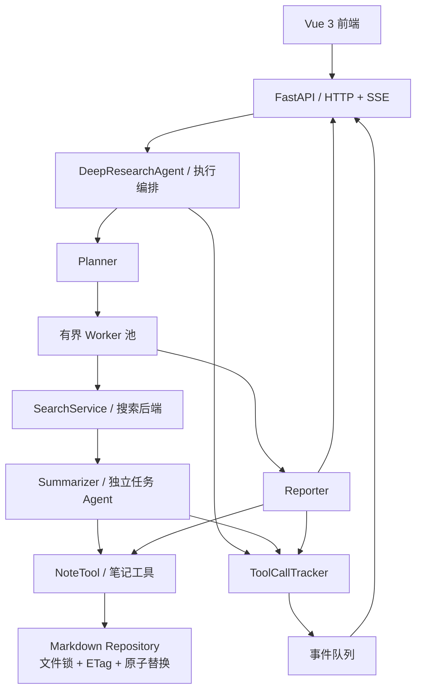

# DeepResearch Agent｜自动化深度研究系统

> 基于 [Datawhale Hello-Agents](https://github.com/datawhalechina/hello-agents) 第十四章 **DeepResearch** 示例进行二次开发，聚焦研究任务编排、并发可靠性、笔记数据一致性和工具执行可观测性。
>
> **项目性质：开源项目改编与工程增强，并非从零原创全部研究工作流。** 原有 Planner / Search / Summarizer / Reporter 架构予以保留；本文将原版能力与改造重点分别说明。

## 项目概览

DeepResearch Agent 面向需要多来源资料检索和综合分析的研究任务。用户输入研究主题后，系统通过大语言模型拆解研究任务，并发执行搜索与总结，启用 files_v2 时通过项目 note 工具保存中间研究笔记，最终输出 Markdown 研究报告。前端通过 SSE 展示任务进度、工具调用和实时总结。

**技术栈**：Python、HelloAgents、FastAPI、Pydantic、Vue 3、TypeScript、Vite、SSE、Linux 多线程 / 多进程、Markdown 文件存储。

**运行环境**：优先面向单机 WSL2 / Linux。支持 OpenAI 兼容的模型接口；搜索后端依据配置选择（如 Tavily、DuckDuckGo 等）。部分服务需要自行提供 API Key。

## 功能与改造重点

| 模块 | 原版提供的能力 | 二次开发重点 |
| --- | --- | --- |
| 研究工作流 | Planner 拆分任务，Search 检索，Summarizer 总结，Reporter 生成报告 | 修复同步执行与异常路径，统一任务、研究及笔记状态 |
| 并发执行 | 多个研究子任务并行运行 | 有界 Worker、并发准入、超时与协作式取消，管理后台任务生命周期 |
| 笔记管理 | NoteTool 创建、读取和更新 Markdown 笔记 | 跨进程文件锁、ETag 版本校验、原子写入、路径校验及报告幂等归属 |
| 工具追踪 | ToolCallTracker 记录工具调用，SSE 推送事件 | 线程安全事件编号、可信任务关联、失败结果识别与事件交接 |
| 前端交互 | Vue 界面展示任务、来源、总结及最终报告 | 完善失败/取消状态、断流处理与旧请求状态隔离 |

### 关键技术设计

**1. 有界并发与执行生命周期**  
通过受控 Worker 池限制单次研究的并发任务数，以研究级执行上下文协调状态、截止时间和取消信号。取消采用协作机制：停止后续调度并尽可能释放请求资源，**不承诺立即中断所有阻塞中的第三方 API 调用**。

**2. Markdown 笔记一致性**  
保留 Markdown 作为笔记内容的权威来源。Agent 写入在工作区级锁保护下完成版本校验，并通过同目录临时文件、`fsync` 和原子替换提交。使用 ETag 检测基于过期笔记生成的更新，防止静默覆盖；采用安全的笔记 ID 与路径校验。允许完整保存后的手工编辑在下一次读取时生效；与 Agent 写入重叠的编辑需遵守协作保护边界。

**3. 可信工具事件与流式交互**  
将工具执行结果关联到具体研究与子任务，区分研究总结成功与笔记落盘成功；通过线程安全队列将任务状态、工具事件和总结片段汇入 SSE，前端按请求身份处理事件，避免旧请求覆盖新研究的显示状态。

## 系统架构

工作流中的 **搜索通常由编排器调用 SearchService**；NoteTool 则通过 Agent 的工具调用流程使用。图中事件箭头表达主要关系，并未穷尽所有内部回调路径。

## 本地运行（WSL2 / Linux）

当前 G0–G5 与安全 Repository 接线已完成自动化验收；真实模型效果、真实浏览器/代理链和提供商取消行为仍待人工验收。历史阶段报告描述当时状态，当前启动策略以这里和[后端运行手册](code/chapter14/helloagents-deepresearch/backend/README.md)为准。

| 项目 | 已验收版本/要求 |
|---|---|
| 系统 | 单机 WSL2/Linux；本机发行版注册名 Ubuntu22.04.3，Ubuntu VERSION_ID=22.04 |
| 后端 | CPython **3.12.14**，uv **0.12.7**，hello-agents **0.2.9**，使用现有 uv.lock |
| 前端 | Node **24.15.0** / npm **11.12.1**，使用 G5 后 package-lock.json |
| 服务 | 后端 127.0.0.1:8000；Vite **5174**；均先在本机验证 |
| 笔记 | 明确选择 ENABLE_NOTES=false，或显式 files_v2 + 激活的新目录；裸默认配置会拒绝启动 |

全部项目操作在 WSL 内执行，Windows 入口目录不是开发副本。以下命令定位并核对本机唯一仓库；其他 Linux 主机须调整实际仓库和工具路径。

### 1. 后端独立环境与无笔记启动

该示例只建立新的忽略环境，不改 backend/.venv。服务不自动加载正式 .env，由操作者在当前终端导出配置。

~~~bash
DR_ROOT=/home/nhzj121/Agent/codex/projects/hello-agents/deep_search/hello-agents-source
cd "$DR_ROOT" || exit 1
test "$(git rev-parse --show-toplevel)" = "$DR_ROOT" || exit 1
DR_BACKEND="$DR_ROOT/code/chapter14/helloagents-deepresearch/backend"
DR_BASE=/home/nhzj121/.local/share/uv/python/cpython-3.12.14-linux-x86_64-gnu/bin/python3.12
DR_UV=/home/nhzj121/.local/bin/uv
"$DR_BASE" -c 'import sys; assert sys.version_info[:3] == (3,12,14)' || exit 1
mkdir -p "$DR_ROOT/venv" || exit 1
DR_ENV="$(mktemp -d "$DR_ROOT/venv/deepresearch-runtime-XXXXXX")" || exit 1
(
  cd "$DR_BACKEND" || exit 1
  test "$(git rev-parse --show-toplevel)" = "$DR_ROOT" || exit 1
  UV_PROJECT_ENVIRONMENT="$DR_ENV" "$DR_UV" sync --locked --no-dev --python "$DR_BASE"
) || exit 1
DR_PY="$DR_ENV/bin/python"
"$DR_UV" pip check --python "$DR_PY" || exit 1
printf '保存本次解释器路径：%s\n' "$DR_PY"

export ENABLE_NOTES=false
unset NOTES_STORAGE NOTES_V2_WORKSPACE NOTES_WORKSPACE NOTES_PROTECTED_WORKSPACES
PYTHONPATH="$DR_BACKEND/src" "$DR_PY" -m services.notes_runtime check || exit 1
"$DR_PY" -m uvicorn main:app --app-dir "$DR_BACKEND/src" --host 127.0.0.1 --port 8000
~~~

另一个 WSL 终端：

~~~bash
cd /home/nhzj121/Agent/codex/projects/hello-agents/deep_search/hello-agents-source || exit 1
test "$(git rev-parse --show-toplevel)" = "$PWD" || exit 1
curl --fail http://127.0.0.1:8000/healthz
~~~

预期 {"status":"ok"}。健康检查不调用模型/搜索；研究请求仍需要可用提供商。提交真实请求前，按后端手册配置 LLM_PROVIDER、LLM_BASE_URL、LLM_MODEL_ID、LLM_API_KEY 及搜索后端（例如 SEARCH_API=tavily + TAVILY_API_KEY），然后启动服务；本次工程收尾不设置真实凭据或执行收费请求。也可使用已部署的 Ollama/LM Studio，不能把“本地模型”当作搜索自动离线。

无笔记模式下，任务总结和报告照常输出，任务/报告 note_status=disabled、无成功 note_id；没有笔记保存失败被隐藏为成功。

### 2. files_v2 安全笔记模式

仅在需要持久化时选择：

| 环境变量 | 意义 |
|---|---|
| ENABLE_NOTES=true | 明确启用笔记 |
| NOTES_STORAGE=files_v2 | 明确选择新存储，无旧 NoteTool 回退 |
| NOTES_V2_WORKSPACE | 独立、已激活的新目标绝对路径 |
| NOTES_WORKSPACE | 原旧源的真实绝对路径，**只作保护，不是新写入目标** |
| NOTES_PROTECTED_WORKSPACES | 其他保护源的 JSON 路径数组 |

按[后端手册第 3 节](code/chapter14/helloagents-deepresearch/backend/README.md#3-启动前必须选择一种笔记模式)创建独立空新目录，执行 services.notes_runtime init，再 check；不要使用原 notes/，不迁移旧数据。首次 init 与之后重启使用已有激活目录是不同操作，重启不再次 init。路径/标记/保护清单非法应拒绝，不能静默降级。新目标优先放 checkout 外；任意自定义目录的 Markdown 不自动受到 Git 忽略保护。

文件为权威存储，完整手工保存后下次读取可见；ETag 不能解决所有不协作编辑器竞争，高安全编辑使用 manual-begin/manual-end 窗口。具体命令和恢复边界见后端手册。

### 3. 前端：G5 后必须按新锁重新安装

新终端定位到同一个 WSL 仓库。G5 只更新了依赖文件，**原 node_modules/dist 没有被替换**，需要重新 npm ci；不要沿用旧安装。

~~~bash
DR_ROOT=/home/nhzj121/Agent/codex/projects/hello-agents/deep_search/hello-agents-source
cd "$DR_ROOT" || exit 1
test "$(git rev-parse --show-toplevel)" = "$DR_ROOT" || exit 1
DR_NODE=/home/nhzj121/.nvm/versions/node/v24.15.0/bin/node
export PATH="$(dirname "$DR_NODE"):$PATH"
"$DR_NODE" --version
npm --version
cd "$DR_ROOT/code/chapter14/helloagents-deepresearch/frontend" || exit 1
test "$(git rev-parse --show-toplevel)" = "$DR_ROOT" || exit 1
npm ci --ignore-scripts || exit 1
npm run build || exit 1
VITE_API_BASE_URL=http://localhost:8000 npm run dev -- --host 127.0.0.1 --port 5174 --strictPort
~~~

本轮/G5 的 --ignore-scripts 安装已通过 esbuild 和实际构建验证，不需要放开额外安装脚本。npm ci 会重建所选目录的 node_modules；本轮验收只在独立副本执行，未替用户重装原目录。

浏览器访问 **http://localhost:5174**。--strictPort 避免端口占用时静默改号；失败时先识别自己的占用进程，不批量终止。前端默认 API 为 http://localhost:8000；VITE_API_BASE_URL 在 Vite 启动/构建时生效。若 WSL 到宿主浏览器 localhost 转发不通，应单独检查该链路，不能默认通过扩大监听地址解决。

### 4. 停止、降级与真实验证

- 停止新研究并确认已开始的模型/搜索实际收尾后，分别在前后端终端 Ctrl+C，等待进程退出。浏览器停止接收、done 或服务进程退出均不能证明远端停止计费；目前无公共 idle/drain API，未确认收尾时不要并排启动替代执行器或切换工作区。
- 安全降级为显式 ENABLE_NOTES=false，check 后重启。保留新目录、标记与全部新笔记；恢复时指回同一激活目录并 check，不能覆盖新数据、复制标记重绑定或恢复旧不安全 NoteTool。
- HTTP 路径保持 GET /healthz、POST /research、POST /research/stream；请求仍为 topic/search_api。SSE type 保留，run_status、任务执行状态和笔记状态分别判定，EOF 无终止帧属于协议错误。
- 默认每进程最多 2 个研究、每研究 3 个活跃 Worker、最多 8 个规划任务，deadline 180 秒；均是可配置的工程默认值，不是提供商配额或强制终止时限。

[工程收尾报告与人工验证清单](docs/deepresearch_closeout_results.md)包含真实 LLM/Search、浏览器、取消、笔记核对的步骤和通过标准。本次只执行 Fake/Mock，未替用户运行下面的真实研究请求：

~~~bash
# 仅由操作者在配置好真实服务后手工执行；可能产生 API 费用。
cd /home/nhzj121/Agent/codex/projects/hello-agents/deep_search/hello-agents-source || exit 1
test "$(git rev-parse --show-toplevel)" = "$PWD" || exit 1
curl --no-buffer http://127.0.0.1:8000/research/stream \
  -H 'Content-Type: application/json' \
  -d '{"topic":"Linux epoll 的实现机制","search_api":"tavily"}'
~~~

## 测试与验证

G0–G5 已覆盖隔离构建安装、同步/流式执行、文本过滤、跨线程/进程笔记一致性、可信工具关联、前端状态、ASGI 断连与容量生命周期。G5 的 178 项 tests 与 21 项前端 checks 是其当次证据，本轮复跑结果另见工程收尾报告，不混写历史记录。

Fake/Mock 验收使用 TemporaryDirectory，禁止访问旧笔记或使用真实 key。全套安全复跑脚本为 docs/g5_evidence/run_backend_regressions.py（使用新的根 venv/ 子目录和独立输出目录）；它会保护既有合成证据。直接运行个别 G3/G4a.2/storage activation 测试会重写历史样本，应先按脚本保存/恢复。

真实提供商、浏览器 DOM、代理链、停服收尾及长期负载仍需人工验收；G4b 总体输入/输出预算及 G6 能力扩展未实施。

## 项目来源与个人贡献

本项目以 Datawhale 社区 [Hello-Agents](https://github.com/datawhalechina/hello-agents) 的[第十四章 DeepResearch 示例](https://github.com/datawhalechina/hello-agents/tree/main/code/chapter14/helloagents-deepresearch)为基础。

**保留的原版设计**：Planner / Search / Summarizer / Reporter 研究流程、HelloAgents 工具调用框架、NoteTool 笔记协作及 FastAPI + Vue 流式交互。

**个人改造范围**：源码审计与缺陷修复、执行调度与取消控制、Markdown 存储安全与一致性、工具事件关联、前后端错误处理及自动化验收。相关改造应以具体提交和测试证据为准，不将原作者实现描述为个人从零开发。

### 许可证说明

上游 Hello-Agents 仓库声明采用 **[CC BY-NC-SA 4.0](https://creativecommons.org/licenses/by-nc-sa/4.0/)**（署名—非商业性使用—相同方式共享）许可协议，参见其 [LICENSE.txt](https://github.com/datawhalechina/hello-agents/blob/main/LICENSE.txt)。本项目应保留原作者署名、来源链接及修改说明；共享涉及上游作品的改编材料时遵守适用的相同方式共享和非商业性使用条件。第三方依赖或独立组件可能适用各自许可证，应分别核对。

本仓库为个人学习与非商业性技术展示用途，**不是 Datawhale 官方发行版本，也不代表获得官方背书**。如需商业使用或重新授权，请事先核查相关权利与许可条件。
