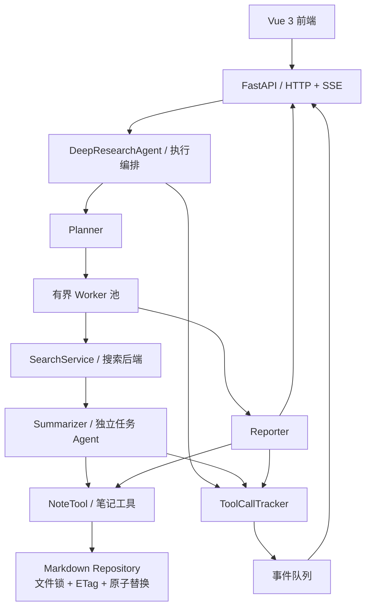

# DeepResearch Agent｜自动化深度研究系统

> 基于 [Datawhale Hello-Agents](https://github.com/datawhalechina/hello-agents) 第十四章 **DeepResearch** 示例进行二次开发，聚焦研究任务编排、并发可靠性、笔记数据一致性和工具执行可观测性。
>
> **项目性质：开源项目改编与工程增强，并非从零原创全部研究工作流。** 原有 Planner / Search / Summarizer / Reporter 架构予以保留；本文将原版能力与改造重点分别说明。

## 项目概览

DeepResearch Agent 面向需要多来源资料检索和综合分析的研究任务。用户输入研究主题后，系统通过大语言模型拆解研究任务，并发执行搜索与总结，使用 NoteTool 保存中间研究笔记，最终输出 Markdown 研究报告。前端通过 SSE 展示任务进度、工具调用和实时总结。

**技术栈**：Python、HelloAgents、FastAPI、Pydantic、Vue 3、TypeScript、Vite、SSE、Linux 多线程 / 多进程、Markdown 文件存储。

**运行环境**：优先面向单机 WSL2 / Linux。支持 OpenAI 兼容的模型接口；搜索后端依据配置选择（如 Tavily、DuckDuckGo 等）。部分服务需要自行提供 API Key。

## 功能与改造重点

| 模块 | 原版提供的能力 | 二次开发重点 |
| --- | --- | --- |
| 研究工作流 | Planner 拆分任务，Search 检索，Summarizer 总结，Reporter 生成报告 | 修复同步执行与异常路径，统一任务、研究及笔记状态 |
| 并发执行 | 多个研究子任务并行运行 | 有界 Worker、并发准入、超时与协作式取消，管理后台任务生命周期 |
| 笔记管理 | NoteTool 创建、读取和更新 Markdown 笔记 | 跨进程文件锁、ETag 版本校验、原子写入、路径校验及报告幂等归属 |
| 工具追踪 | ToolCallTracker 记录工具调用，SSE 推送事件 | 线程安全事件编号、可信任务关联、失败结果识别与事件交接 |
| 前端交互 | Vue 界面展示任务、来源、总结及最终报告 | 完善失败/取消状态、断流处理与旧请求状态隔离 |

### 关键技术设计

**1. 有界并发与执行生命周期**  
通过受控 Worker 池限制单次研究的并发任务数，以研究级执行上下文协调状态、截止时间和取消信号。取消采用协作机制：停止后续调度并尽可能释放请求资源，**不承诺立即中断所有阻塞中的第三方 API 调用**。

**2. Markdown 笔记一致性**  
保留 Markdown 作为笔记内容的权威来源。Agent 写入在工作区级锁保护下完成版本校验，并通过同目录临时文件、`fsync` 和原子替换提交。使用 ETag 检测基于过期笔记生成的更新，防止静默覆盖；采用安全的笔记 ID 与路径校验。允许完整保存后的手工编辑在下一次读取时生效；与 Agent 写入重叠的编辑需遵守协作保护边界。

**3. 可信工具事件与流式交互**  
将工具执行结果关联到具体研究与子任务，区分研究总结成功与笔记落盘成功；通过线程安全队列将任务状态、工具事件和总结片段汇入 SSE，前端按请求身份处理事件，避免旧请求覆盖新研究的显示状态。

## 系统架构



工作流中的 **搜索通常由编排器调用 SearchService**；NoteTool 则通过 Agent 的工具调用流程使用。图中事件箭头表达主要关系，并未穷尽所有内部回调路径。

## 本地运行

以下命令以仓库中保留的原版目录结构为例。实际运行前，请安装 Python、[uv](https://docs.astral.sh/uv/) 和 Node.js/npm，并确认本地代码及锁文件与所使用的版本一致。

### 1. 启动后端

```bash
cd code/chapter14/helloagents-deepresearch/backend
uv sync --locked
```

配置模型和搜索服务（以下以 OpenAI 兼容模型接口和 Tavily 为例；**不要将真实 Key 提交到仓库**）：

```bash
export LLM_PROVIDER=custom
export LLM_BASE_URL="https://<your-openai-compatible-api>/v1"
export LLM_MODEL_ID="<your-model-id>"
export LLM_API_KEY="<your-llm-api-key>"
export SEARCH_API=tavily
export TAVILY_API_KEY="<your-tavily-api-key>"
```

```bash
uv run uvicorn main:app --app-dir src --host 127.0.0.1 --port 8000
```

检查服务：

```bash
curl http://127.0.0.1:8000/healthz
```

应返回 `{"status":"ok"}`。若使用 Ollama、LM Studio 或其他搜索后端，请调整相应环境变量；部分搜索后端需要额外部署或配置。

> **笔记工作区注意事项**：改造版本使用受保护的独立 Markdown 工作区。必须按实际配置与迁移文档指定经过验证的目录；不要直接将旧版笔记目录作为并发测试、故障注入或自动迁移目标。具体新增配置名称以最终实现为准。

### 2. 启动前端

新开终端，进入前端目录：

```bash
cd code/chapter14/helloagents-deepresearch/frontend
npm ci
npm run dev
```

浏览器访问终端显示的本地地址（Vite 通常为 `http://localhost:5173`）。前端默认请求 `http://localhost:8000`，可通过 `VITE_API_BASE_URL` 调整。

### 3. API 示例

```bash
curl -N http://127.0.0.1:8000/research/stream \
  -H 'Content-Type: application/json' \
  -d '{"topic":"Linux epoll 的实现机制","search_api":"tavily"}'
```

接口采用 `text/event-stream` 返回研究事件。同步接口为 `POST /research`；健康检查接口为 `GET /healthz`。实际请求可能调用付费模型或搜索服务。

## 测试与验证

本项目的改造验收重点包括：

- **核心正确性**：同步/流式执行、异常任务状态、思考内容过滤及生成器关闭。
- **并发与存储**：多线程/多进程创建、过期 ETag 冲突、路径越界、故障注入及原子写入。
- **事件与前端**：工具事件唯一性与任务归属、SSE 异常终止、请求取消及界面状态一致性。
- **环境可复现**：独立虚拟环境构建、后端启动、前端依赖与构建验证。

运行测试时应使用 Fake/Mock 模型、搜索服务及临时笔记目录，避免消耗真实 API 额度或损坏研究数据。**具体测试命令、通过数量和性能指标应以仓库最终提交的测试文件及验收报告为准；此处不预填未经复核的数据。**

## 项目来源与个人贡献

本项目以 Datawhale 社区 [Hello-Agents](https://github.com/datawhalechina/hello-agents) 的[第十四章 DeepResearch 示例](https://github.com/datawhalechina/hello-agents/tree/main/code/chapter14/helloagents-deepresearch)为基础。

**保留的原版设计**：Planner / Search / Summarizer / Reporter 研究流程、HelloAgents 工具调用框架、NoteTool 笔记协作及 FastAPI + Vue 流式交互。

**个人改造范围**：源码审计与缺陷修复、执行调度与取消控制、Markdown 存储安全与一致性、工具事件关联、前后端错误处理及自动化验收。相关改造应以具体提交和测试证据为准，不将原作者实现描述为个人从零开发。

### 许可证说明

上游 Hello-Agents 仓库声明采用 **[CC BY-NC-SA 4.0](https://creativecommons.org/licenses/by-nc-sa/4.0/)**（署名—非商业性使用—相同方式共享）许可协议，参见其 [LICENSE.txt](https://github.com/datawhalechina/hello-agents/blob/main/LICENSE.txt)。本项目应保留原作者署名、来源链接及修改说明；共享涉及上游作品的改编材料时遵守适用的相同方式共享和非商业性使用条件。第三方依赖或独立组件可能适用各自许可证，应分别核对。

本仓库为个人学习与非商业性技术展示用途，**不是 Datawhale 官方发行版本，也不代表获得官方背书**。如需商业使用或重新授权，请事先核查相关权利与许可条件。
