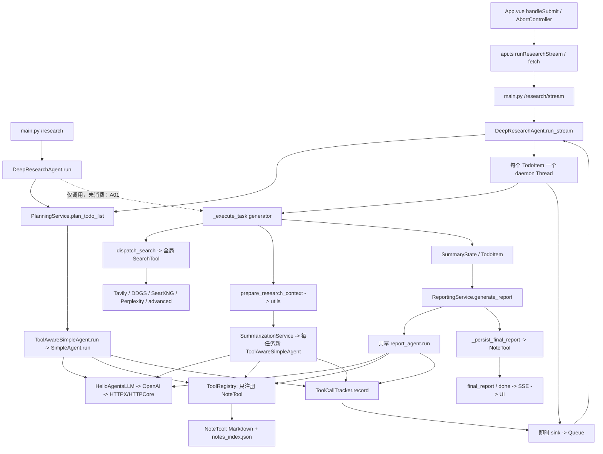

# HelloAgents DeepResearch 源码核查与问题验证报告

审计日期：2026-11-02（Asia/Shanghai）。本报告只描述当前本地工作区与已安装框架，不以 GitHub main 分支代替本地版本。未修改业务源码、配置、依赖、锁文件，未安装依赖，未提交或推送。新增内容仅为本报告、独立复现脚本与审计证据。

## 1. 核查结论与范围

现有流式演示能够运行，不代表同步接口、异常路径、并发笔记和取消路径正确。已经复现同步研究任务未执行、失败状态不一致、思考文本流式泄漏、关闭生成器时再次 yield、笔记覆盖、事件 ID 重复、错误笔记关联、前端请求竞争及干净安装障碍。另发现畸形思考标签可令文本清理函数不终止。

同时排除了几项过强判断：共享 LLM 对象并不天然不安全；正常 Worker 生产事件的路径没有复现事件丢失或重复；Reporter 确实获得任务状态与来源缺失信息；最终报告落盘通常会复用 Reporter 已创建的一个报告笔记，不会无条件再建一份。

| 分类 | 定义 |
|---|---|
| 已确认缺陷 Axx | 当前实现有具体错误路径，并给出最小复现或明确源码证据 |
| 潜在风险 Rxx | 行为/边界已核实，但故障需要特定条件，或实际线上影响尚无证据 |
| 设计取舍 Dxx | 当前功能边界或实现选择；没有需求依据时不算 Bug |
| 新增功能建议 Nxx | 现有项目没有承诺的新能力，不纳入原版缺陷数量 |
| 安全维护 S01 | 锁文件命中已知漏洞；依赖受影响已核实，实际可利用性另行判断 |

严重程度：P0 为全服务不可用、广泛数据破坏等最高紧急情况；P1 为核心接口错误、可复现数据丢失、资源取消/安装的重要障碍；P2 为关联、展示、健壮性等局部问题。这里不沿用参考文档把同步接口问题直接定为 P0：流式路径仍可工作。

验证范围：30 项 Python 离线测试、10 项前端源码执行检查、1 项临时构建探针、npm 全量与生产依赖只读审计。测试断言的是“当前缺陷确实存在”或“特定路径工作正常”，全部通过不代表缺陷已修复。未进行真实模型/搜索 API 调用或收费测试。

用户已确认：之前成功运行后端使用项目内 backend/.venv。核查时未发现运行中的 uvicorn/Vite 项目进程。

## 2. 当前工作区版本与证据定位

### 2.1 仓库与路径

- WSL2 发行版：Ubuntu22.04.3；所有项目操作在 Linux 内执行。
- 仓库根目录 R：`/home/nhzj121/Agent/codex/projects/hello-agents/deep_search/hello-agents-source`。
- 研究目录 P：`R/code/chapter14/helloagents-deepresearch`。
- 后端 B：`P/backend`；前端 F：`P/frontend`。
- 框架 H：`B/.venv/lib/python3.12/site-packages/hello_agents`。
- 第三方库 S：`B/.venv/lib/python3.12/site-packages`。
- 当前分支 main；提交 `755ae75958e6fb072c8a075bcbc55ad15d98bb17`，提交时间 2026-10-31T21:12:28+08:00，说明 Initial commit。
- origin：`https://github.com/nhzj121/agent.git`。未 fetch/pull；本地 origin/main 不能证明远端此刻仍一致。
- 审计开始时：已跟踪文件无修改，仅根目录 AGENTS.md 未跟踪。审计新增 docs/。最终只读核验记录见 [R/docs/audit_evidence/integrity.json](/home/nhzj121/Agent/codex/projects/hello-agents/deep_search/hello-agents-source/docs/audit_evidence/integrity.json)。
- 官方项目链接仅用于确认来源背景，未据其 main 分支推定本地代码：[Datawhale Hello-Agents](https://github.com/datawhalechina/hello-agents)。

正文的 B/F/H/S 简写均对应上述实际绝对路径；源码链接定位到具体起始行，附近范围在文字中注明。审计证据、完整依赖版本和源码 SHA256 见 [R/docs/audit_evidence/environment.json](/home/nhzj121/Agent/codex/projects/hello-agents/deep_search/hello-agents-source/docs/audit_evidence/environment.json)。已安装 hello-agents 的 Python 文件与其安装 RECORD 哈希未发现不一致。

参考线索为 Windows 入口目录中的《HelloAgents_DeepResearch_问题分析与改造计划.md》《HelloAgents_DeepResearch_问题清单与改造路线图.md》。本报告重新验证其判断，编号和优先级不与旧文档混用。

### 2.2 目录与依赖

```text
R/
├── AGENTS.md
├── code/chapter14/helloagents-deepresearch/
│   ├── backend/
│   │   ├── pyproject.toml / uv.lock / .venv/
│   │   ├── src/
│   │   │   ├── main.py / agent.py / config.py / models.py / prompts.py / utils.py
│   │   │   └── services/{planner,summarizer,reporter,search,notes,text_processing,tool_events}.py
│   │   └── notes/                  # 原有数据，本次测试不使用
│   └── frontend/
│       ├── package.json / package-lock.json / vite.config.ts
│       └── src/{main.ts,App.vue,style.css,services/api.ts}
└── docs/                          # 本次审计交付物
```

| 组件 | 当前安装/锁定版本 | 证据 |
|---|---|---|
| 后端解释器 | CPython 3.12.14；pyproject 允许 >=3.10 | [B/.venv/pyvenv.cfg:1](/home/nhzj121/Agent/codex/projects/hello-agents/deep_search/hello-agents-source/code/chapter14/helloagents-deepresearch/backend/.venv/pyvenv.cfg:1)；[B/pyproject.toml:10](/home/nhzj121/Agent/codex/projects/hello-agents/deep_search/hello-agents-source/code/chapter14/helloagents-deepresearch/backend/pyproject.toml:10)；environment.json |
| hello-agents | 0.2.9，声明与锁文件相同 | [B/pyproject.toml:13](/home/nhzj121/Agent/codex/projects/hello-agents/deep_search/hello-agents-source/code/chapter14/helloagents-deepresearch/backend/pyproject.toml:13)；[B/uv.lock:413](/home/nhzj121/Agent/codex/projects/hello-agents/deep_search/hello-agents-source/code/chapter14/helloagents-deepresearch/backend/uv.lock:413) |
| FastAPI / Starlette / Uvicorn | 0.119.1 / 0.48.0 / 0.38.0 | environment.json |
| OpenAI SDK / HTTPX / HTTPCore | 1.109.1 / 0.28.1 / 1.0.9 | environment.json |
| Pydantic / AnyIO | 2.12.3 / 4.11.0 | environment.json |
| Tavily / DDGS / Requests | 0.7.12 / 9.6.1 / 2.32.5 | environment.json |
| huggingface_hub | 当前额外安装 2.3.0，uv.lock 不包含 | environment.json；A16 |
| Linux Node / npm | v24.15.0 / 11.12.1 | 使用 ~/.nvm/versions/node/v24.15.0 下的 Linux 可执行文件 |
| Vue / Axios | package-lock 锁定 3.5.22 / 1.12.2 | [F/package-lock.json:1714](/home/nhzj121/Agent/codex/projects/hello-agents/deep_search/hello-agents-source/code/chapter14/helloagents-deepresearch/frontend/package-lock.json:1714)；[F/package-lock.json:1033](/home/nhzj121/Agent/codex/projects/hello-agents/deep_search/hello-agents-source/code/chapter14/helloagents-deepresearch/frontend/package-lock.json:1033) |
| Vite / Rollup / esbuild | 锁定 6.4.1 / 4.52.5 / 0.25.11 | [F/package-lock.json:1632](/home/nhzj121/Agent/codex/projects/hello-agents/deep_search/hello-agents-source/code/chapter14/helloagents-deepresearch/frontend/package-lock.json:1632)；[F/package-lock.json:1543](/home/nhzj121/Agent/codex/projects/hello-agents/deep_search/hello-agents-source/code/chapter14/helloagents-deepresearch/frontend/package-lock.json:1543)；environment.json/锁文件 |
| TypeScript / vue-tsc / plugin-vue | 锁定 5.9.3 / 2.2.12 / 5.2.4 | package-lock 与现有 node_modules，测试直接使用已安装 TypeScript/Vue |

实际环境并非锁文件的精确重建：click 为 8.5.0、锁定 8.3.0；idna 为 3.20、锁定 3.11；额外存在 huggingface-hub、hf-xet、fsspec、httpx2 等包。版本漂移本身不等于项目错误，但不能用“现有环境能启动”证明锁文件足以重建。

## 3. 模块依赖与调用关系

### 3.1 研究执行图



这里的 SearchTool 由编排器直接调用，不在 Agent 工具注册表中。Reporter 没有网页搜索工具；模型也没有收到原始网页检索能力。Planner、Reporter 是同一个研究实例内各一个 Agent；每个总结任务创建独立 Agent，彼此的 _history 不共享，但 LLM、NoteTool、ToolRegistry、Tracker 共享。

### 3.2 全部业务模块的职责与入口

| 模块/函数 | 调用与依赖 |
|---|---|
| [B/src/main.py:69](/home/nhzj121/Agent/codex/projects/hello-agents/deep_search/hello-agents-source/code/chapter14/helloagents-deepresearch/backend/src/main.py:69) _build_config；create_app、两个研究路由 | 请求 search_api 覆盖环境配置；每个 HTTP 请求创建 DeepResearchAgent；同步调用 run，流式把字典编码为单行 JSON SSE |
| [B/src/config.py:16](/home/nhzj121/Agent/codex/projects/hello-agents/deep_search/hello-agents-source/code/chapter14/helloagents-deepresearch/backend/src/config.py:16) Configuration / from_env | Pydantic 验证环境变量和请求覆盖；包含模型地址、笔记、搜索开关等；不代表每个字段都被执行层使用 |
| [B/src/models.py:10](/home/nhzj121/Agent/codex/projects/hello-agents/deep_search/hello-agents-source/code/chapter14/helloagents-deepresearch/backend/src/models.py:10) TodoItem / SummaryState / SummaryStateOutput | dataclass 保存任务状态、来源、报告、笔记路径；status 是任意字符串，无状态机/枚举验证 |
| [B/src/agent.py:35](/home/nhzj121/Agent/codex/projects/hello-agents/deep_search/hello-agents-source/code/chapter14/helloagents-deepresearch/backend/src/agent.py:35) __init__ / _init_llm / _create_tool_aware_agent | 创建共享依赖、Planner/Reporter 和总结 Agent 工厂；只注册 NoteTool |
| [B/src/agent.py:125](/home/nhzj121/Agent/codex/projects/hello-agents/deep_search/hello-agents-source/code/chapter14/helloagents-deepresearch/backend/src/agent.py:125) run / run_stream / _execute_task | 规划→任务搜索/总结→最终报告→笔记落盘；同步路径存在 A01 |
| [B/src/services/planner.py:31](/home/nhzj121/Agent/codex/projects/hello-agents/deep_search/hello-agents-source/code/chapter14/helloagents-deepresearch/backend/src/services/planner.py:31) plan_todo_list / _extract_tasks | Planner Agent 的工具轮次结束后解析最终 JSON；按实际解析顺序分配 id；最后清理 history（非 finally） |
| [B/src/services/search.py:23](/home/nhzj121/Agent/codex/projects/hello-agents/deep_search/hello-agents-source/code/chapter14/helloagents-deepresearch/backend/src/services/search.py:23) dispatch_search / prepare_research_context | 配置覆盖全局 SearchTool 的默认 backend；统一结果/notice；调用 utils 去重与格式化 |
| [B/src/services/summarizer.py:28](/home/nhzj121/Agent/codex/projects/hello-agents/deep_search/hello-agents-source/code/chapter14/helloagents-deepresearch/backend/src/services/summarizer.py:28) summarize_task / stream_task_summary | 使用新 Agent；组合网页 context 与笔记指引；过滤思考/工具标记；同步 clear 在 finally，流式有 A03/A04 |
| [B/src/services/notes.py:10](/home/nhzj121/Agent/codex/projects/hello-agents/deep_search/hello-agents-source/code/chapter14/helloagents-deepresearch/backend/src/services/notes.py:10) build_note_guidance | 有 note_id 则提示 read/update，否则提示 create；实际是否调用和成功取决于模型与工具结果 |
| [B/src/services/reporter.py:22](/home/nhzj121/Agent/codex/projects/hello-agents/deep_search/hello-agents-source/code/chapter14/helloagents-deepresearch/backend/src/services/reporter.py:22) generate_report | 汇总每个任务的状态、总结、来源和 note_id；提示读取笔记并可创建 conclusion；最终调用非流式 Agent.run |
| [B/src/services/tool_events.py:41](/home/nhzj121/Agent/codex/projects/hello-agents/deep_search/hello-agents-source/code/chapter14/helloagents-deepresearch/backend/src/services/tool_events.py:41) record / drain / set_event_sink | 保存工具事件、推断 task_id、解析 note_id、回填任务、即时推送；并发边界见 A05/A08/A09/R03 |
| [B/src/services/text_processing.py:8](/home/nhzj121/Agent/codex/projects/hello-agents/deep_search/hello-agents-source/code/chapter14/helloagents-deepresearch/backend/src/services/text_processing.py:8) strip_tool_calls | 用正则删除残余工具文本；嵌套数组有 A11 |
| [B/src/utils.py:19](/home/nhzj121/Agent/codex/projects/hello-agents/deep_search/hello-agents-source/code/chapter14/helloagents-deepresearch/backend/src/utils.py:19) strip_thinking_tokens；deduplicate_and_format_sources / format_sources | 完整文本思考过滤、来源上下文和列表；A19 与 R06 |
| [B/src/prompts.py:10](/home/nhzj121/Agent/codex/projects/hello-agents/deep_search/hello-agents-source/code/chapter14/helloagents-deepresearch/backend/src/prompts.py:10) 三阶段系统提示词与 get_current_date | 规划提示 3–5 任务、笔记读写协作与报告格式；提示不是并发上限或后置校验 |
| [F/src/main.ts:1](/home/nhzj121/Agent/codex/projects/hello-agents/deep_search/hello-agents-source/code/chapter14/helloagents-deepresearch/frontend/src/main.ts:1) / [F/src/App.vue:671](/home/nhzj121/Agent/codex/projects/hello-agents/deep_search/hello-agents-source/code/chapter14/helloagents-deepresearch/frontend/src/App.vue:671) | Vue 挂载、任务视图、请求与取消、事件更新；样式无研究执行逻辑 |
| [F/src/services/api.ts:18](/home/nhzj121/Agent/codex/projects/hello-agents/deep_search/hello-agents-source/code/chapter14/helloagents-deepresearch/frontend/src/services/api.ts:18) runResearchStream | fetch POST、UTF-8 增量解码、LF 双换行分帧、JSON 分发 |

### 3.3 HelloAgents 的底层执行和导入链

**Agent。** [H/agents/tool_aware_agent.py:18](/home/nhzj121/Agent/codex/projects/hello-agents/deep_search/hello-agents-source/code/chapter14/helloagents-deepresearch/backend/.venv/lib/python3.12/site-packages/hello_agents/agents/tool_aware_agent.py:18) 没有重写 run，因此执行 [H/agents/simple_agent.py:246](/home/nhzj121/Agent/codex/projects/hello-agents/deep_search/hello-agents-source/code/chapter14/helloagents-deepresearch/backend/.venv/lib/python3.12/site-packages/hello_agents/agents/simple_agent.py:246)。每轮 invoke 完整回答后，用子类的 _parse_tool_calls 解析标记，再串行执行本轮所有工具；结果以 user 消息回填，最多默认 3 轮，达到上限可再 invoke 一次，这次 fallback 回答不再解析工具。正常返回只保存最初输入与最终回答两条 history；中间工具对话仅存在本次局部 messages 中。[H/core/agent.py:23](/home/nhzj121/Agent/codex/projects/hello-agents/deep_search/hello-agents-source/code/chapter14/helloagents-deepresearch/backend/.venv/lib/python3.12/site-packages/hello_agents/core/agent.py:23) 的 history 为每实例列表，clear_history 在第 34 行直接 clear，无锁。

**流式 Agent。** [H/agents/tool_aware_agent.py:302](/home/nhzj121/Agent/codex/projects/hello-agents/deep_search/hello-agents-source/code/chapter14/helloagents-deepresearch/backend/.venv/lib/python3.12/site-packages/hello_agents/agents/tool_aware_agent.py:302) 自己实现 stream_run。process_residual 保留 marker 的尾部，支持跨 chunk 工具标记和嵌套数组；先消费完该轮 LLM 流，再在第 384–405 行执行工具。并非“见到工具标记立刻中断模型并执行”。监听器在工具执行后调用（第 83–102 行），没有 registry 或找不到工具时提前返回，不会触发监听。正常结束在第 421 行写 history；异常/关闭没有框架级 finally 负责关闭 LLM 流或清 history。Python T24 验证调用顺序与正常 history。

**LLM。** [H/core/llm.py:36](/home/nhzj121/Agent/codex/projects/hello-agents/deep_search/hello-agents-source/code/chapter14/helloagents-deepresearch/backend/.venv/lib/python3.12/site-packages/hello_agents/core/llm.py:36) 保存配置和一个 OpenAI 客户端，没有任务级 messages/history；invoke、think 的 response/迭代变量均局部。流式 stream_invoke 仅转发 temperature，不转发调用时的 timeout/max_tokens 等额外 kwargs（第 337–343 行）；invoke 会转发额外 kwargs。实例创建时 timeout 来自参数或 LLM_TIMEOUT，默认 60 秒（第 64、232 行），覆盖 SDK 默认值。OpenAI 默认 max_retries=2，见 [S/openai/_constants.py:10](/home/nhzj121/Agent/codex/projects/hello-agents/deep_search/hello-agents-source/code/chapter14/helloagents-deepresearch/backend/.venv/lib/python3.12/site-packages/openai/_constants.py:10)；这是连接/读写超时与重试配置，不是研究全流程的总截止时间。

**HTTP 客户端并发。** [S/httpx/_client.py:594](/home/nhzj121/Agent/codex/projects/hello-agents/deep_search/hello-agents-source/code/chapter14/helloagents-deepresearch/backend/.venv/lib/python3.12/site-packages/httpx/_client.py:594) 的同步 Client 明确支持线程共享；[S/httpcore/_sync/connection_pool.py:123](/home/nhzj121/Agent/codex/projects/hello-agents/deep_search/hello-agents-source/code/chapter14/helloagents-deepresearch/backend/.venv/lib/python3.12/site-packages/httpcore/_sync/connection_pool.py:123) 对连接池状态加锁。T22 用真实 OpenAI/HTTPX + MockTransport 并发 8 次调用，返回与输入一一对应。没有发现当前只读配置下 HelloAgentsLLM 必须每 Worker 单独实例化的证据。运行时修改共享 model/temperature、并发 close 客户端等不在当前路径内，仍不可据此推定安全。

**资源释放。** [H/core/llm.py:285](/home/nhzj121/Agent/codex/projects/hello-agents/deep_search/hello-agents-source/code/chapter14/helloagents-deepresearch/backend/.venv/lib/python3.12/site-packages/hello_agents/core/llm.py:285) think 对 OpenAI 流没有 with/finally/close。[S/openai/_streaming.py:103](/home/nhzj121/Agent/codex/projects/hello-agents/deep_search/hello-agents-source/code/chapter14/helloagents-deepresearch/backend/.venv/lib/python3.12/site-packages/openai/_streaming.py:103) 提供上下文管理和 close；完整消费一般会释放响应，提前结束应明确关闭。T23 保留 SDK 流句柄后关闭 HelloAgents 生成器，HTTP 流仍未 closed；显式 close 后才关闭。未做真实连接池耗尽压测，因此结论是“提前退出时释放未保证”，不是“每次正常调用都泄漏”。

**安装导入链。** hello_agents.__init__ → agents/工具注册表导入 → tools 与 tools/builtin 的 eager imports → evaluation/data_generation → dataset.py 顶层导入 huggingface_hub。这是当前普通 DeepResearch 导入也会触发的链，不是用户调用评估功能之后才出现；详见 A16。

## 4. 已确认缺陷

### A01 同步 run 没有执行任务生成器 — P1，已复现

证据：[B/src/agent.py:125](/home/nhzj121/Agent/codex/projects/hello-agents/deep_search/hello-agents-source/code/chapter14/helloagents-deepresearch/backend/src/agent.py:125) run 第 135–136 行仅调用 _execute_task；[B/src/agent.py:289](/home/nhzj121/Agent/codex/projects/hello-agents/deep_search/hello-agents-source/code/chapter14/helloagents-deepresearch/backend/src/agent.py:289) 内含 yield，整个函数都是生成器，emit_stream=False 不改变此性质。

执行路径：POST /research → run → Planner 生成 TODO → 得到并丢弃 generator → 直接 Reporter。搜索、总结、状态更新完全未执行。T01 结果 search_calls=0、任务仍 pending，但报告照常返回。

改造：最小修复是显式完整迭代；长期可拆分执行和事件，但本轮不需要先重构。HTTP 字段不必变化，同步接口的模型调用、搜索耗时和费用会恢复为真实工作量。

### A02 Worker 异常事件与 TodoItem 状态不一致 — P1，已复现

证据：[B/src/agent.py:203](/home/nhzj121/Agent/codex/projects/hello-agents/deep_search/hello-agents-source/code/chapter14/helloagents-deepresearch/backend/src/agent.py:203) worker 的 except 第 220–234 行只 enqueue failed；[B/src/agent.py:298](/home/nhzj121/Agent/codex/projects/hello-agents/deep_search/hello-agents-source/code/chapter14/helloagents-deepresearch/backend/src/agent.py:298) 已把任务置 in_progress，失败分支没有修改对象。

路径：搜索或总结异常 → SSE failed → finally 发送 __task_done__ → 全部 Worker 结束后 Reporter 读取仍 in_progress 的任务。T02 复现 failed 事件、in_progress 对象、仍产出 final_report。

改造：同一状态转换同时更新对象与事件。done 仅表示流程结束，不能替代每任务成功。保持接口结构；下游将得到正确 failed，报告不能再把失败当进行中。

### A03 开始思考标记跨 chunk 时，思考内容对用户可见 — P1，已复现

证据：[B/src/services/summarizer.py:59](/home/nhzj121/Agent/codex/projects/hello-agents/deep_search/hello-agents-source/code/chapter14/helloagents-deepresearch/backend/src/services/summarizer.py:59) flush_visible 未找到完整 <think> 时，第 65–68 行把所有尾部内容发出，不保留可能的标签前缀。

T10 输入 `["<thi", "nk>SECRET", "</think>visible"]`，SSE 实际拼接 `<think>SECRET</think>visible`；最终 get_summary 又清成 visible。最终结果干净不能撤回已经发送给客户端的内容。

改造：有状态地识别标签、保留不完整前缀；覆盖关闭标签跨片段、未闭合标签和畸形顺序。SSE 事件字段不变，仅输出内容修正。

### A04 finally 再 yield 可导致关闭失败并跳过 clear_history — P1，已复现

证据：[B/src/services/summarizer.py:82](/home/nhzj121/Agent/codex/projects/hello-agents/deep_search/hello-agents-source/code/chapter14/helloagents-deepresearch/backend/src/services/summarizer.py:82) generator 第 96–102 行在 finally 调用可 yield 的 flush_visible，clear_history 排在其后。

T11：单 chunk 为 `prefix<think>secret</think>TAIL`；先消费 prefix 再 close。关闭进入 finally，跳过完整思考块后仍 yield TAIL，触发 RuntimeError: generator ignored GeneratorExit；此时 clear_history 尚未执行。并非所有 close 都触发，关键是还有可见尾部待刷新。Python 的关闭规则见 [generator.close 官方语义](https://docs.python.org/3.12/reference/expressions.html#generator.close)。

改造：正常结束才刷新文本；finally 只负责不 yield 的清理，并显式关闭内层流。接口不变，错误/取消路径停止异常产出。

### A05 ToolCallEvent.id 可并发重复 — P2，已复现

证据：[B/src/services/tool_events.py:61](/home/nhzj121/Agent/codex/projects/hello-agents/deep_search/hello-agents-source/code/chapter14/helloagents-deepresearch/backend/src/services/tool_events.py:61) 在锁外 `len(_events)+1`，第 72 行才锁住 append。

T07 在事件构造处设置屏障，强制两线程都读到空列表再 append，得到 ID [1,1]。这是对合法调度的控制，不是把计数算法替换成错误实现；GIL 不让跨多条语句成为原子操作。

改造：编号分配与 append 放在同一锁内，或独立原子序列。字段类型可保持整数；目前前端没有按 event_id 去重，因此不能反推“重复 ID 已经导致所有事件被丢弃”。

### A06 同一 NoteTool 并发创建可覆盖笔记 — P1，已复现

证据：[H/tools/builtin/note_tool.py:119](/home/nhzj121/Agent/codex/projects/hello-agents/deep_search/hello-agents-source/code/chapter14/helloagents-deepresearch/backend/.venv/lib/python3.12/site-packages/hello_agents/tools/builtin/note_tool.py:119) ID=秒级时间戳+当前索引长度；[H/tools/builtin/note_tool.py:298](/home/nhzj121/Agent/codex/projects/hello-agents/deep_search/hello-agents-source/code/chapter14/helloagents-deepresearch/backend/.venv/lib/python3.12/site-packages/hello_agents/tools/builtin/note_tool.py:298) 第 318 行分配 ID、第 338 行以 w 写文件、第 342 行后才 append 索引。没有锁或独占创建。

T14 固定“同一秒”的时钟并在分配 ID 后设置两线程屏障：两次均返回成功、ID 相同、仅一个 Markdown 文件，内存索引却有两条记录。真实路径是并发 Summarizer 在 Planner 未建好笔记时同时 create；每请求新 NoteTool 的跨请求路径风险更大。

改造：唯一 ID、独占创建、写入和索引一致性。单实例锁只覆盖当前实例，不能解决多个 HTTP 请求或多个进程。建议保留不透明字符串 note_id，但迁移时兼容旧 ID 和文件。

### A07 更新和索引保存不是并发安全事务 — P1，已复现

证据：[H/tools/builtin/note_tool.py:379](/home/nhzj121/Agent/codex/projects/hello-agents/deep_search/hello-agents-source/code/chapter14/helloagents-deepresearch/backend/.venv/lib/python3.12/site-packages/hello_agents/tools/builtin/note_tool.py:379) 第 399–420 行读整份笔记后整体重写；第 423–429 行更新索引；[H/tools/builtin/note_tool.py:99](/home/nhzj121/Agent/codex/projects/hello-agents/deep_search/hello-agents-source/code/chapter14/helloagents-deepresearch/backend/.venv/lib/python3.12/site-packages/hello_agents/tools/builtin/note_tool.py:99) 只在实例初始化读取索引，_save_index 第 116 行直接以 w 重写 JSON。

T15：两个线程先读取同一旧笔记，一个改 tags，一个改 title；按控制顺序保存后 title 生效而 tags 回到旧值，独立更新被覆盖。T16：两个 NoteTool 同时加载空索引，随后分别创建不同 ID；最终磁盘有两个笔记，索引只有后一次的记录，甚至不需要写操作真正同时发生。

单进程内 asyncio 化不能自动修复这些文件读改写。直接写 JSON 的中途读取/进程崩溃还可能见到不完整文件，这是额外潜在风险，未用真实项目数据复现。

改造：针对当前可多请求的服务，使用跨实例的存储协调、原子落盘和更新冲突控制；SQLite 事务是一个选项，文件锁+版本号也可行。单纯换 UUID 只解决 A06，不能解决本项。

### A08 笔记失败后任务仍成功，且可回填不存在的 note_id — P2，已复现

证据：[H/agents/tool_aware_agent.py:75](/home/nhzj121/Agent/codex/projects/hello-agents/deep_search/hello-agents-source/code/chapter14/helloagents-deepresearch/backend/.venv/lib/python3.12/site-packages/hello_agents/agents/tool_aware_agent.py:75) 工具异常/错误被包装为字符串，NoteTool 的业务失败本身也返回 ❌ 文本；[B/src/services/tool_events.py:56](/home/nhzj121/Agent/codex/projects/hello-agents/deep_search/hello-agents-source/code/chapter14/helloagents-deepresearch/backend/src/services/tool_events.py:56) 不检查成功就使用参数 note_id；[B/src/services/tool_events.py:100](/home/nhzj121/Agent/codex/projects/hello-agents/deep_search/hello-agents-source/code/chapter14/helloagents-deepresearch/backend/src/services/tool_events.py:100) 回填到任务；[B/src/agent.py:396](/home/nhzj121/Agent/codex/projects/hello-agents/deep_search/hello-agents-source/code/chapter14/helloagents-deepresearch/backend/src/agent.py:396) 只要总结返回便 completed。

T19 让真实 ToolAwareSimpleAgent 调用 NoteTool 更新 missing 笔记，随后 Fake LLM 正常给出总结：工具事件含失败，但任务 completed。T09 进一步证实 task.note_id 可变为 missing。

研究总结成功与笔记同步成功是两种状态；现有提示词要求“同步笔记后输出”，当前实现没有程序保证。不能把研究任务一律 failed 作为唯一答案，但至少应独立标记笔记失败，并禁止附着无效 ID。

改造影响：可保留 completed 表示研究完成，同时增加 note_status/warnings；若改为严格失败策略，需要前后端共同确认业务语义。

### A09 仅凭 note_id 的工具事件无法关联已知任务 — P2，已复现

证据：[B/src/services/tool_events.py:181](/home/nhzj121/Agent/codex/projects/hello-agents/deep_search/hello-agents-source/code/chapter14/helloagents-deepresearch/backend/src/services/tool_events.py:181) _infer_task_id 只看参数 task_id、tags 中 task_数字、标题中的“任务 数字”，不查询已有 note_id→task 映射；[B/src/services/notes.py:16](/home/nhzj121/Agent/codex/projects/hello-agents/deep_search/hello-agents-source/code/chapter14/helloagents-deepresearch/backend/src/services/notes.py:16) 推荐的 read 参数恰好只有 action/note_id。

T08 先用 create 正确关联任务，再 read 相同 note_id：read 事件 task_id=None。即时 sink 不带当前 Worker 上下文，前端 [F/src/App.vue:890](/home/nhzj121/Agent/codex/projects/hello-agents/deep_search/hello-agents-source/code/chapter14/helloagents-deepresearch/frontend/src/App.vue:890) 无法存入该任务的 toolCalls，仅留通用日志。原 task.note_id 通常仍在，并非所有笔记读取功能都失效。

推断顺序也不验证冲突：错误的显式 task_id 优先于正确 tags，非锚定 task_正则可匹配包含该片段的任意标签；这是潜在误关联条件。

改造：从编排上下文传入可信 task_id，或查询已验证 note_id 映射；保留标签推断作为兼容兜底并校验冲突。无需改变现有事件主字段。

### A10 最终报告笔记匹配过宽，可覆盖任务结论 — P1，已复现

证据：[B/src/agent.py:505](/home/nhzj121/Agent/codex/projects/hello-agents/deep_search/hello-agents-source/code/chapter14/helloagents-deepresearch/backend/src/agent.py:505) _find_existing_report_note_id 第 521–525 行把任意 note_type=conclusion 视为报告候选，或只要 title.startswith("研究报告")；不验证主题、run、report 标签、工具成功状态。

T17 将“task finding”任务笔记记录为 conclusion，查找最终报告 ID 时选中该任务笔记。随后 [B/src/agent.py:458](/home/nhzj121/Agent/codex/projects/hello-agents/deep_search/hello-agents-source/code/chapter14/helloagents-deepresearch/backend/src/agent.py:458) 会把其标题、tags、content 全量改为最终报告，从而覆盖任务内容。

HTTP 每次新建 Agent，因此“任意历史磁盘笔记都会被扫描选中”是误报：查找只看当前 Tracker；但手动复用同一个 Agent 跨主题运行时，Tracker 未 reset 又可能命中上一次事件。

改造：显式保存当前 run 的 report_note_id，严格验证阶段/用途/成功状态，禁止以通用 conclusion 类型替代报告归属。笔记内容行为改变，需保护和迁移既有笔记。

### A11 工具标记清理正则不能处理嵌套数组 — P2，已复现

证据：[B/src/services/text_processing.py:8](/home/nhzj121/Agent/codex/projects/hello-agents/deep_search/hello-agents-source/code/chapter14/helloagents-deepresearch/backend/src/services/text_processing.py:8) 匹配到第一个 ] 就结束；Planner 的 TOOL_CALL_PATTERN 也有同样的语法局限，见 [B/src/services/planner.py:19](/home/nhzj121/Agent/codex/projects/hello-agents/deep_search/hello-agents-source/code/chapter14/helloagents-deepresearch/backend/src/services/planner.py:19)（只有其兜底工具表达式解析路径受此影响）。

T13：`A[TOOL_CALL:note:{"tags":["task_1"],"content":"C"}]Z` 清理后残留 `A,"content":"C"}]Z`。同一输入由 ToolAwareSimpleAgent 的嵌套解析器可正确识别。因此不能宣称“底层 Agent 的工具解析也都不支持数组”。

改造：复用支持嵌套与字符串转义的解析机制。接口无变化，最终文本应不再残留参数碎片；不要用更贪婪的单个正则跨多个工具标记删除正文。

### A12 SSE 提前 EOF 被当作正常结束，回调异常被吞 — P2，已复现

证据：[F/src/services/api.ts:49](/home/nhzj121/Agent/codex/projects/hello-agents/deep_search/hello-agents-source/code/chapter14/helloagents-deepresearch/frontend/src/services/api.ts:49) 读到 done=true 便在第 77–94 行成功返回，没有验证收到终止事件；第 61–70 行把 JSON.parse 与 onEvent 包在同一 catch。[F/src/App.vue:944](/home/nhzj121/Agent/codex/projects/hello-agents/deep_search/hello-agents-source/code/chapter14/helloagents-deepresearch/frontend/src/App.vue:944) 成功返回但无报告时填“暂无生成的报告”，finally 关闭 loading；状态栏第 145 行仅用 loading 判断“流程完成”。

F03：只有 status 帧便结束的流 Promise 正常 resolve。F04：onEvent 抛错被打印成“解析流式事件失败”，对调用方没有异常。真实网络中断若 fetch 抛 AbortError/网络错误仍会 reject，本项针对无终止事件的干净 EOF 或损坏帧被吞后的假成功，不能扩大为“所有断线都被忽略”。

改造：区分解析错误和应用回调错误，跟踪 done/error/final_report 终止条件，异常 EOF 明确失败；finally 释放 reader。协议字段可不变，但原本静默成功的异常路径会显式报错。

### A13 前端 failed/cancelled 处理不完整 — P2，已复现

证据：[F/src/App.vue:409](/home/nhzj121/Agent/codex/projects/hello-agents/deep_search/hello-agents-source/code/chapter14/helloagents-deepresearch/frontend/src/App.vue:409) 只有 pending/in_progress/completed/skipped 的中文标签；[F/src/App.vue:774](/home/nhzj121/Agent/codex/projects/hello-agents/deep_search/hello-agents-source/code/chapter14/helloagents-deepresearch/frontend/src/App.vue:774) 虽保存任意 status，却仅为 in_progress/completed/skipped 更新细节日志，不展示 failed.detail。[F/src/App.vue:947](/home/nhzj121/Agent/codex/projects/hello-agents/deep_search/hello-agents-source/code/chapter14/helloagents-deepresearch/frontend/src/App.vue:947) AbortError 只写日志，不改变未终结任务的 status；后端没有 cancelled 事件分支。

F07 验证 failed 字符串确实被存储，故“完全不处理 failed”不准确；但错误原因不进入 task.notices/error，标签直接显示 failed。F09 验证取消后任务仍显示 in_progress。completed、skipped 基本路径可用；completedTasks 只统计成功，不能把 skipped 是否计为“完成”直接判 Bug，需要明确进度含义。

改造：失败详情和终态映射补齐，研究级状态与任务成功计数分开；新增 cancelled 事件/字段时需协调前后端。当前展开页缺少原表单上的“取消研究”按钮，主要通过“开始新研究”触发取消，可一并调整交互。

### A14 旧请求收尾会清除新请求的 loading — P1，已复现

证据：[F/src/App.vue:976](/home/nhzj121/Agent/codex/projects/hello-agents/deep_search/hello-agents-source/code/chapter14/helloagents-deepresearch/frontend/src/App.vue:976) startNewResearch 取消并立即清空视图；[F/src/App.vue:671](/home/nhzj121/Agent/codex/projects/hello-agents/deep_search/hello-agents-source/code/chapter14/helloagents-deepresearch/frontend/src/App.vue:671) 新 handleSubmit 可在旧 Promise 收尾前开始；[F/src/App.vue:953](/home/nhzj121/Agent/codex/projects/hello-agents/deep_search/hello-agents-source/code/chapter14/helloagents-deepresearch/frontend/src/App.vue:953) finally 无条件 loading=false，只有 currentController 的清理有 controller 身份检查。

F08：启动 A → 开始新研究取消 A → 立即启动 B → A 的 catch/finally 执行 → B 的 loading 变 false。这与旧请求的实际外部模型是否被取消无关。

改造：用当前请求身份约束 loading、错误、报告及事件更新，防止旧流回写新视图。接口不变，改善重开研究时的竞争行为。

### A15 后端当前打包配置无法构建项目包 — P1，离线构建已复现

证据：[B/pyproject.toml:30](/home/nhzj121/Agent/codex/projects/hello-agents/deep_search/hello-agents-source/code/chapter14/helloagents-deepresearch/backend/pyproject.toml:30) packages=["src"] 与 package-dir={"":"src"} 组合会查找 src/src，而实际源码位于 backend/src/*.py 和 src/services/。第 8 行 readme="README.md" 指向缺失文件，构建给出警告；README 警告不是本次构建失败的直接原因。

独立探针把 pyproject 和 src 复制到临时目录，使用已有 uv 缓存 setuptools 84.2.1（满足声明 >=73）和 wheel，不安装任何包；build_wheel 返回 error: package directory 'src/src' does not exist。完整输出 [R/docs/audit_evidence/build-probe.txt](/home/nhzj121/Agent/codex/projects/hello-agents/deep_search/hello-agents-source/docs/audit_evidence/build-probe.txt)，复现脚本 [R/docs/audit_build_probe.py](/home/nhzj121/Agent/codex/projects/hello-agents/deep_search/hello-agents-source/docs/audit_build_probe.py)。

不能由“从 src 启动 main:app 可运行”推导“pip install . / uv sync 可安装项目本身”。改造应明确选择平铺模块+services 包、标准命名包布局，或明确以不安装项目包的脚本模式启动。前两种会影响包发现/入口；不要机械只改一个 packages 字段而漏掉 services 或平铺模块。

### A16 锁文件缺少普通启动必需的 huggingface_hub — P1，已复现导入障碍

证据：[B/pyproject.toml:11](/home/nhzj121/Agent/codex/projects/hello-agents/deep_search/hello-agents-source/code/chapter14/helloagents-deepresearch/backend/pyproject.toml:11)、[B/uv.lock:434](/home/nhzj121/Agent/codex/projects/hello-agents/deep_search/hello-agents-source/code/chapter14/helloagents-deepresearch/backend/uv.lock:434) 未声明/锁定 huggingface-hub；[H/tools/builtin/__init__.py:28](/home/nhzj121/Agent/codex/projects/hello-agents/deep_search/hello-agents-source/code/chapter14/helloagents-deepresearch/backend/.venv/lib/python3.12/site-packages/hello_agents/tools/builtin/__init__.py:28) 导入 LLMJudgeTool；[H/tools/builtin/llm_judge_tool.py:13](/home/nhzj121/Agent/codex/projects/hello-agents/deep_search/hello-agents-source/code/chapter14/helloagents-deepresearch/backend/.venv/lib/python3.12/site-packages/hello_agents/tools/builtin/llm_judge_tool.py:13) 导入 data_generation.dataset；[H/evaluation/benchmarks/data_generation/dataset.py:14](/home/nhzj121/Agent/codex/projects/hello-agents/deep_search/hello-agents-source/code/chapter14/helloagents-deepresearch/backend/.venv/lib/python3.12/site-packages/hello_agents/evaluation/benchmarks/data_generation/dataset.py:14) 在顶层无保护地导入 huggingface_hub。框架 METADATA 仅 evaluation extra 声明它，基本依赖不包含。

T25 在独立子进程中屏蔽唯一 huggingface_hub 导入，普通 import hello_agents 即抛 ModuleNotFoundError。当前 .venv 额外装有该包，所以目前启动成功和这个缺陷可以同时成立。

这是“锁文件运行依赖不闭合”的已确认问题；全新环境实际安装、联网解析和启动仍待验证，未执行安装命令。不要直接启用完整 evaluation extra：它附带大量本项目不使用的依赖，且框架该 extra 声明 huggingface_hub<1.0，与当前额外安装 2.3.0 不是同一环境。

改造：短期声明经过验证的最小启动依赖并重新生成锁文件；长期修正/升级框架的可选模块 eager import。后续必须在独立干净环境验证，不能以手工补包作为验收。

### A17 NoteTool 的 note_id 可越过笔记目录边界 — P1，受控临时目录已复现

证据：[H/tools/builtin/note_tool.py:125](/home/nhzj121/Agent/codex/projects/hello-agents/deep_search/hello-agents-source/code/chapter14/helloagents-deepresearch/backend/.venv/lib/python3.12/site-packages/hello_agents/tools/builtin/note_tool.py:125) 直接返回 workspace / f"{note_id}.md"，未限制绝对路径或 ../；read、update、delete 均采用该路径。模型提供的 note_id 可到达 [H/agents/tool_aware_agent.py:83](/home/nhzj121/Agent/codex/projects/hello-agents/deep_search/hello-agents-source/code/chapter14/helloagents-deepresearch/backend/.venv/lib/python3.12/site-packages/hello_agents/agents/tool_aware_agent.py:83) tool.run。

T29 仅在临时目录中创建 outer/inner 两个笔记空间：inner 用 ../outer/<id> 读取并更新 outer 的笔记，均成功。测试没有访问或更改任何真实项目外文件。

可利用范围受后端用户权限、.md 后缀和更新解析要求约束；未证明任意非 Markdown 文件可被写，也未构造真实提示词注入攻击。路径越界能力本身已确认，恶意搜索内容/用户主题诱导模型调用是进一步威胁条件。

改造：ID 白名单、resolve 后验证目录边界、已知 ID/研究归属检查。接口字段不必改变，但此前接受的路径型 ID 应被拒绝。

### A18 Planner 的工具事件在前端丢失结构化任务记录 — P2，已复现

证据：[B/src/agent.py:156](/home/nhzj121/Agent/codex/projects/hello-agents/deep_search/hello-agents-source/code/chapter14/helloagents-deepresearch/backend/src/agent.py:156) Planner 后立即 drain 并 yield tool_call，然后第 168 行才发送 todo_list。[F/src/App.vue:890](/home/nhzj121/Agent/codex/projects/hello-agents/deep_search/hello-agents-source/code/chapter14/helloagents-deepresearch/frontend/src/App.vue:890) 此时 findTask 找不到尚未建成的任务，只写通用日志；第 720–762 行创建任务时 toolCalls=[]。

F10 用真实 App.vue 回调先投递带 task_id 的 tool_call 再投递 todo_list，任务 toolCalls 为空。后端 SSE 没丢事件，丢失的是 UI 中归属于任务的结构化记录。任务的 note_id 可通过稍后的 todo_list 保留下来，不能说任务笔记因此消失。

改造：前端暂存待关联工具事件，或先发送 todo_list 再发规划阶段记录。事件排序调整需要前端兼容测试，现有主字段可保留。

### A19 畸形思考标签顺序可使文本清理无限循环 — P1，已复现

证据：[B/src/utils.py:19](/home/nhzj121/Agent/codex/projects/hello-agents/deep_search/hello-agents-source/code/chapter14/helloagents-deepresearch/backend/src/utils.py:19) strip_thinking_tokens 只要求两个标签都存在；start 取首个 <think>，end 却取全文首个 </think>，未保证后者位于 start 之后。

最小输入为 `</think><think>`：start=8、end=8，`text[:start]+text[end:]` 不改变文本，while 永远为真。T30 在独立子进程先输出 entered，再调用真实函数；0.6 秒超时后由测试终止子进程。源码的不动点证明它不是“模型响应慢”。

路径包括 Planner._extract_tasks、同步 Summarizer、Reporter 的清理，以及流式总结收尾清理。单个畸形模型输出即可卡住调用线程；正常网络超时不能中断这段本地循环。

改造：按 start 之后寻找结束标签，或统一使用能保证前进/终止的解析器；明确未闭合/反向标签规则。接口不变，应与 A03 同阶段修复。

## 5. 潜在风险、设计取舍与排除的误报

### 5.1 取消、线程与事件生命周期

| 编号/性质 | 证据与已验证边界 | 建议/影响 |
|---|---|---|
| R01 P1：取消只断开消费，没有研究取消机制 | [F/src/App.vue:961](/home/nhzj121/Agent/codex/projects/hello-agents/deep_search/hello-agents-source/code/chapter14/helloagents-deepresearch/frontend/src/App.vue:961) AbortController 确实传给 fetch；[B/src/main.py:157](/home/nhzj121/Agent/codex/projects/hello-agents/deep_search/hello-agents-source/code/chapter14/helloagents-deepresearch/backend/src/main.py:157) 未接收 Request.is_disconnected 或 cancellation token；[B/src/agent.py:238](/home/nhzj121/Agent/codex/projects/hello-agents/deep_search/hello-agents-source/code/chapter14/helloagents-deepresearch/backend/src/agent.py:238) Worker 是 daemon Thread；第 262–265 行 close 时 join 无超时。T05 显式关闭生成器会等待 Fake 搜索释放，Worker 仍做完总结；T28 经真实 StreamingResponse 的 ASGI 2.3 disconnect 路径，断开后 Worker 仍在运行。 | 实现行为已确认。若产品“取消研究”承诺停止费用/计算，这是必须补齐的功能缺口；若仅停止显示，则是有成本风险的设计选择。引入协作取消、检查点和总体截止时间；不能强杀 Python 线程，也不能把 task.cancel 等同于取消同步 HTTP。 |
| R02 P1：无任务并发硬上限 | [B/src/agent.py:238](/home/nhzj121/Agent/codex/projects/hello-agents/deep_search/hello-agents-source/code/chapter14/helloagents-deepresearch/backend/src/agent.py:238) 对每个解析出的任务 thread.start；[B/src/services/planner.py:47](/home/nhzj121/Agent/codex/projects/hello-agents/deep_search/hello-agents-source/code/chapter14/helloagents-deepresearch/backend/src/services/planner.py:47) 不截断任务数组；[B/src/prompts.py:17](/home/nhzj121/Agent/codex/projects/hello-agents/deep_search/hello-agents-source/code/chapter14/helloagents-deepresearch/backend/src/prompts.py:17) 仅提示 3–5 个。 | 超量输出或并发 HTTP 请求可能放大资源与费用，未做资源耗尽压测。并发配置/研究预算属于新增接口或环境配置。 |
| R03 P2：Tracker 回调与状态回填边界 | [B/src/services/tool_events.py:94](/home/nhzj121/Agent/codex/projects/hello-agents/deep_search/hello-agents-source/code/chapter14/helloagents-deepresearch/backend/src/services/tool_events.py:94) 切片/游标在锁内；task 回填在锁外；set_event_sink 第 140 行无锁，callback 第 84 行锁外执行；[B/src/agent.py:415](/home/nhzj121/Agent/codex/projects/hello-agents/deep_search/hello-agents-source/code/chapter14/helloagents-deepresearch/backend/src/agent.py:415) drain 后启用 sink 时抑制返回事件。 | 不应宣称整个 Tracker 无锁或正常必然重发。callback 抛错、运行中切 sink、跨线程回填等需单独定义保证；框架会吞 listener 异常，事件仍可留在存储而未送达。当前 enqueue 正常不抛错，未复现正常链路丢事件。 |
| R04 P2：LLM 流提前退出释放未保证 | H/core/llm.py:285；S/openai/_streaming.py:103；T23。 | 显式关闭每次响应；不要在一个 Worker 取消时 close 所有 Worker 共用的整个客户端。真实服务端生成是否继续和计费是否停止待服务商验证。 |
| R05 P2：Planner/Reporter 异常未调用 clear_history | [B/src/services/planner.py:39](/home/nhzj121/Agent/codex/projects/hello-agents/deep_search/hello-agents-source/code/chapter14/helloagents-deepresearch/backend/src/services/planner.py:39)、[B/src/services/reporter.py:67](/home/nhzj121/Agent/codex/projects/hello-agents/deep_search/hello-agents-source/code/chapter14/helloagents-deepresearch/backend/src/services/reporter.py:67) 只有成功返回后才 clear。T12 模拟异常验证清理未调用；同步 Summarizer 在 finally 会 clear。 | 当前 HTTP 每请求新建 Agent，而且 SimpleAgent 抛异常前通常尚未保存最终 history，不能宣称普通首轮失败必然跨请求泄漏历史。改成 finally 是稳健性修复，复用 Agent 前尤其需要。 |
| R06 P2：上下文预算局部而非总预算 | [B/src/utils.py:53](/home/nhzj121/Agent/codex/projects/hello-agents/deep_search/hello-agents-source/code/chapter14/helloagents-deepresearch/backend/src/utils.py:53) content 不截断，仅 raw_content 按 4 字符/token 截断；[B/src/services/search.py:94](/home/nhzj121/Agent/codex/projects/hello-agents/deep_search/hello-agents-source/code/chapter14/helloagents-deepresearch/backend/src/services/search.py:94) answer_text 原样前置。T21 单来源+answer 就有 32096 字符。 | 当前参数名是每来源预算，不能假定项目已承诺全流程硬 Token 上限。建议对 snippet/answer/整轮及报告输入设置明确预算并做实际 tokenizer 计量。 |
| R07 P2：最终报告可有多份 conclusion 笔记 | [H/agents/simple_agent.py:283](/home/nhzj121/Agent/codex/projects/hello-agents/deep_search/hello-agents-source/code/chapter14/helloagents-deepresearch/backend/.venv/lib/python3.12/site-packages/hello_agents/agents/simple_agent.py:283) 模型最多多轮工具调用，每轮可有多个 create；[B/src/services/reporter.py:48](/home/nhzj121/Agent/codex/projects/hello-agents/deep_search/hello-agents-source/code/chapter14/helloagents-deepresearch/backend/src/services/reporter.py:48) 每次给 create 模板；T18 创建两条后持久化只更新其中最后一条。 | 普通“一次 create + persist”不会无条件增加第三份；重复由模型工具路径或重跑/恢复语义触发。按 run_id/stage 做幂等归属优于按标题猜测。 |

**正常完成时生产者的生命周期。** Worker 先同步完成 _execute_task，包括该 Worker 的工具监听回调，然后 finally 在同一线程 put __task_done__。Queue 是 FIFO，主线程收齐 N 个 done 后再 get_nowait 清尾队列，最后禁 sink 并 join。当前工具没有在返回后异步另开事件生产者。因此所有正常 Worker 事件都排在各自 done 之前，T04 验证两个任务事件各一次；不能以“Queue.empty 可能竞态”作本项目的证据，因为这里并未用 Queue.empty 作为完成条件。

异常边界仍存在：线程创建发生在 try/finally 之前，若某次 thread.start 抛错，已启动线程没有进入既定清理；客户端提前退出会停止消费队列，之后事件不再送达用户。这些是异常/取消条件，与正常完成后的丢事件分开记录。

**框架内部后台搜索。** [S/ddgs/ddgs.py:47](/home/nhzj121/Agent/codex/projects/hello-agents/deep_search/hello-agents-source/code/chapter14/helloagents-deepresearch/backend/.venv/lib/python3.12/site-packages/ddgs/ddgs.py:47) 存在类级 _executor，初始化第 71 行无锁；每次 SearchTool 虽新建 DDGS，DDGS.__exit__ 第 61–68 行是 pass。搜索第 191 行超时 wait 后没有取消 not_done futures，可能仍有底层工作。未进行真实 DDGS 请求或线程池泄漏压测，所以不把“新建 DDGS”当作取消保证，也不宣称其已经损坏搜索结果。

**HTTP 服务断开语义。** [S/starlette/responses.py:220](/home/nhzj121/Agent/codex/projects/hello-agents/deep_search/hello-agents-source/code/chapter14/helloagents-deepresearch/backend/.venv/lib/python3.12/site-packages/starlette/responses.py:220) 同步迭代器转换为线程池异步迭代；[S/starlette/concurrency.py:55](/home/nhzj121/Agent/codex/projects/hello-agents/deep_search/hello-agents-source/code/chapter14/helloagents-deepresearch/backend/.venv/lib/python3.12/site-packages/starlette/concurrency.py:55) 的 next 使用 anyio.to_thread.run_sync。Starlette 对 ASGI <2.4 监听 disconnect 并取消任务组，对 >=2.4 在 send 报 OSError 时处理 ClientDisconnect。HTTP 层停止发送不会自动取消手动创建的 Worker，也不会中断正在进行的同步搜索/LLM 请求。本次 ASGI 2.3 路径已验证；实际浏览器→反向代理→Uvicorn 的断开延迟、ASGI 2.4 路径、服务商计费停止时间仍待环境集成测试。

### 5.2 SearchTool 的实际行为

| 检查点 | 实现、执行路径与判断 |
|---|---|
| 全局实例是否串改 backend | [B/src/services/search.py:20](/home/nhzj121/Agent/codex/projects/hello-agents/deep_search/hello-agents-source/code/chapter14/helloagents-deepresearch/backend/src/services/search.py:20) 以 hybrid 初始化；每次 dispatch 传 backend；[H/tools/builtin/search_tool.py:138](/home/nhzj121/Agent/codex/projects/hello-agents/deep_search/hello-agents-source/code/chapter14/helloagents-deepresearch/backend/.venv/lib/python3.12/site-packages/hello_agents/tools/builtin/search_tool.py:138) 用局部变量覆盖，不修改 self.backend。初始化后的 key/client/backend 列表在检索中只读，结果与 notices 为局部变量。不能仅凭全局实例判并发 Bug。 |
| 共享后端客户端 | TavilyClient 的 headers/proxies 是共享可变对象，但当前方法不修改它们；[S/tavily/tavily.py:38](/home/nhzj121/Agent/codex/projects/hello-agents/deep_search/hello-agents-source/code/chapter14/helloagents-deepresearch/backend/.venv/lib/python3.12/site-packages/tavily/tavily.py:38) _search 用 requests.post，不共享一个 requests.Session。DDGS 每请求独立实例和 engines_cache，但共享 executor。没有外部真实并发验证，不给“所有后端绝对线程安全”保证。 |
| 覆盖与回退 | [H/tools/builtin/search_tool.py:222](/home/nhzj121/Agent/codex/projects/hello-agents/deep_search/hello-agents-source/code/chapter14/helloagents-deepresearch/backend/.venv/lib/python3.12/site-packages/hello_agents/tools/builtin/search_tool.py:222) hybrid→advanced；advanced 顺序 Tavily→SerpApi→DuckDuckGo，第 529–576 行首个非空即返回，并非同时混合多源；不会自动转 SearXNG/Perplexity。显式选 tavily 等失败会抛，不自动走 advanced。T26 验证显式 DuckDuckGo 覆盖全局 hybrid，以及 advanced 把 Tavily 失败变 notice 后兜底。 |
| 空结果/失败/限流 | Tavily SDK 的 429 在 [S/tavily/tavily.py:102](/home/nhzj121/Agent/codex/projects/hello-agents/deep_search/hello-agents-source/code/chapter14/helloagents-deepresearch/backend/.venv/lib/python3.12/site-packages/tavily/tavily.py:102) 抛 UsageLimitExceededError；advanced 捕获并转 notice，再尝试后端，全部失败可得到空 results+notices→_execute_task skipped；显式后端异常进入 Worker failed（但有 A02）。真实 DDGS 无结果在 [S/ddgs/ddgs.py:214](/home/nhzj121/Agent/codex/projects/hello-agents/deep_search/hello-agents-source/code/chapter14/helloagents-deepresearch/backend/.venv/lib/python3.12/site-packages/ddgs/ddgs.py:214) 也可能抛 DDGSException，而非总返回空列表。没有项目级退避、统一限流分类或任务重试。 |
| 超时 | DDGS 构造 timeout=10；网页 requests.get timeout=10；SearXNG=10；Perplexity requests.post=30，见 search_tool.py:56、378、421、488；Tavily SDK 默认 60，最高截到 120。SerpApi 当前未安装，不能追踪其实际客户端超时。超时不是全任务硬上限，逐网页获取和重试会累加。 |
| loop_count | [B/src/agent.py:303](/home/nhzj121/Agent/codex/projects/hello-agents/deep_search/hello-agents-source/code/chapter14/helloagents-deepresearch/backend/src/agent.py:303) 无锁读，成功有来源后第 354–357 行锁内递增。T06 两次并发搜索都收到 0，最终为 2，未丢增量。[H/tools/builtin/search_tool.py:506](/home/nhzj121/Agent/codex/projects/hello-agents/deep_search/hello-agents-source/code/chapter14/helloagents-deepresearch/backend/.venv/lib/python3.12/site-packages/hello_agents/tools/builtin/search_tool.py:506) 只用于 Perplexity 来源标题 Source N-i，不改变 query、不控制迭代或预算。重复标签是当前影响，不能推断搜索跳轮/结果覆盖。 |
| max_results | 应用固定传 5；Tavily/SerpApi/SearXNG/Perplexity 截取；DDGS 也在 ddgs.py:212 按 max_results 切片。当前任务数与每次结果数是不同限制。 |
| fetch_full_page | Tavily 请求 include_raw_content；DDG/SearXNG 对结果逐页额外 GET；SerpApi 只用 snippet，Perplexity 只用回答正文，不会真实逐页获取。获取失败退回 snippet，markdownify 可选且当前未安装，可能传入 HTML。这个开关不是所有后端“完整网页已获取”的保证。 |
| Token 限制 | [H/tools/builtin/search_tool.py:49](/home/nhzj121/Agent/codex/projects/hello-agents/deep_search/hello-agents-source/code/chapter14/helloagents-deepresearch/backend/.venv/lib/python3.12/site-packages/hello_agents/tools/builtin/search_tool.py:49) 与 utils.py:63 均按 4 字符/token 近似，只截 raw_content；中文不等价于真实 Token。content/answer 可重复注入且未截断（R06）。 |
| answer 无 sources | _execute_task 先检查 results，只有 answer 仍 skipped，T03；当前 Perplexity 有 citation 兜底，因此不能把这个注入场景当作其每次真实调用必现。是否允许无来源答案属于 D04。 |

### 5.3 NoteTool、任务关联和三阶段笔记生命周期

| 阶段 | 实际行为与保证 |
|---|---|
| 创建/返回 | NoteTool.run 只检查必填 action 是否存在，额外 task_id 并不写入持久笔记。create 写 Markdown frontmatter+正文及索引，返回“✅ 笔记创建成功\nID: note_YYYYMMDD_HHMMSS_count…”；Tracker 从该文本提取 ID。更新成功返回“✅ 笔记更新成功: <id>”，因此通常靠原参数 note_id，不靠更新响应解析。见 note_tool.py:194、298、431。 |
| 读取/更新 | read 返回含 ID、类型、tags、内容的格式化文本；update 的 content 是全量替换，不是工具自动增量合并，提示词中的“追加”需要模型自行读后合并；空 content/title 因 if 判断不能用于清空。run 不统一捕获 I/O/JSON 异常，Agent 包装层才会转错误文本；直接持久化报告时异常会继续抛。 |
| Planner | 提示要求为任务创建笔记；工具实际调用后 Tracker 保存事件；最终 JSON 被解析为 TodoItem 后，run/run_stream 的首次 drain 才回填 note_id。这条正常链路可以工作，不要求创建时 TodoItem 已存在。没有程序验证每个任务都已创建笔记。 |
| Summarizer | 若 task.note_id 存在就提示 read/update，否则提示 create；每任务独立 Agent/history。当前并发通常改不同任务笔记，但创建未关联笔记、错误任务归属、多请求共享 workspace 仍会触发 A06/A07。只读 note_id 无 task_id 造成 A09。 |
| Reporter | prompt 包含每任务 status、summary、sources_summary，以及 note_id；提示 read，每个读取动作由模型选择执行；可额外 create conclusion。只有 NoteTool 注册，所以不重新搜索/抓网页。没有确定性的“所有 note 已读完”或“来源已核验”的后置检查。T20 验证 failed 和“暂无来源”确实在 prompt。 |
| 最终落盘 | generate_report 后 drain，_persist_final_report 优先复用匹配到的 note_id，update 返回 ❌ 才改 create；没有 ID 则不发 report_note。普通一次 Reporter create 会被复用，多个 create 则只处理最后一个候选（A10/R07）。直接的持久化动作没有走 ToolAware 监听器，而通过 report_note 单独发事件。 |
| 失败表现 | 业务错误多为 ❌ 文本，底层 I/O/损坏 JSON 可抛异常；工具监听 payload 没有 success 布尔。task.completed 与 note.status 目前无法独立表示，A08；最终报告保存失败可没有 report_note 但仍有 final_report/done，若直接抛异常则 main 输出 error。 |

### 5.4 设计取舍与误报更正

| 编号 | 判断与证据 |
|---|---|
| D01 _last_search_notices | [B/src/agent.py:74](/home/nhzj121/Agent/codex/projects/hello-agents/deep_search/hello-agents-source/code/chapter14/helloagents-deepresearch/backend/src/agent.py:74) 初始化、第 305 行赋值，业务源码没有读取处；task.notices 使用本次局部 notices。它是无用的共享字段，最后写入顺序不确定，但当前没有证据表明它导致用户收到别的任务的 notice。可删除，不应列为已发生竞态故障。 |
| D02 research_loop_count | 是“成功获得来源并加入状态的任务数”，不是唯一任务序号、完整研究轮次或 max_loops 预算。需要重新命名/定义时再改，不要机械把无锁读判为计数丢失。 |
| D03 配置占位与实际执行 | [B/src/config.py:19](/home/nhzj121/Agent/codex/projects/hello-agents/deep_search/hello-agents-source/code/chapter14/helloagents-deepresearch/backend/src/config.py:19) max_web_research_loops 在执行层未读取；use_tool_calling 在第 69 行声明，却不参与 _create_tool_aware_agent 的 enable 判定（依据是 notes registry 是否存在）。当前是每任务一次搜索+总结，不是受该配置控制的反思循环；工具为文本标记，并非 OpenAI 原生 tool_calls。应补文档/移除无效字段，或另立功能需求实现；不要让用户误以为改配置已限制预算。 |
| D04 answer-only 跳过 | 要求有可引用来源可视为合理取舍；允许来源缺失的答案则需明确不确定性，不能不加说明当作等价“已研究”。 |
| D05 Reporter 能识别失败吗 | 它收到明确状态和“暂无来源”，系统提示要求信息缺失时说明；因此“根本不知道输入失败”是误报（A02 会污染状态是另一问题）。模型是否如实承认不足、是否拒绝无证据结论没有确定性质量门禁，需要 Fake prompt 验证与后续真实评测区分。 |
| D06 原始 Markdown 展示 | [F/src/App.vue:271](/home/nhzj121/Agent/codex/projects/hello-agents/deep_search/hello-agents-source/code/chapter14/helloagents-deepresearch/frontend/src/App.vue:271)、第 330 行用 pre 和插值展示；这不是 Markdown 渲染器，没有格式化标题/链接属既有展示范围。引入渲染器是新增功能，必须同时处理不可信内容清洗，不能直接 v-html。 |
| D07 不是完整 SSE 通用解析器 | 当前后端只发 LF 双换行、单 data 行 JSON，F01 验证任意字节切分/中文解码正常。F02 发现 CRLF 多帧失败；注释、event/id、多 data 行也不完整支持。对当前成对实现不能仅凭不支持完整标准判必现 Bug；接入代理/其他 SSE 服务前需补兼容。 |
| D08 reader 未关闭 | [F/src/services/api.ts:65](/home/nhzj121/Agent/codex/projects/hello-agents/deep_search/hello-agents-source/code/chapter14/helloagents-deepresearch/frontend/src/services/api.ts:65) done/error 直接 return，无 releaseLock/cancel；F05 验证本地模拟流仍 locked 且未 cancel。当前后端 done 后本应 EOF，所以不能直接认定每次都会后台无限传输；仍建议在 finally 明确释放。 |

## 6. 前端依赖安全审计 S01

### 6.1 查询范围与结果

在 Linux Node/npm 中执行，只查询锁文件和官方 registry；没有运行 npm install、npm audit fix，也没有更新锁文件：

```bash
npm audit --json --package-lock-only --ignore-scripts --registry=https://registry.npmjs.org
npm audit --json --package-lock-only --ignore-scripts --omit=dev --registry=https://registry.npmjs.org
```

实际使用独立临时 npm cache。命令返回 1 表示有漏洞告警，不是运行异常。

| 范围 | high | moderate | critical | 受影响依赖节点总数 |
|---|---:|---:|---:|---:|
| 全依赖 | 12 | 1 | 0 | 13 |
| omit=dev | 7 | 1 | 0 | 8 |

证据：[R/docs/audit_evidence/npm-audit-all.json](/home/nhzj121/Agent/codex/projects/hello-agents/deep_search/hello-agents-source/docs/audit_evidence/npm-audit-all.json)、[R/docs/audit_evidence/npm-audit-production.json](/home/nhzj121/Agent/codex/projects/hello-agents/deep_search/hello-agents-source/docs/audit_evidence/npm-audit-production.json)。一个包可能对应多个 advisory，以上不是漏洞编号去重后的数量，也不是可利用路径数量。完整 GHSA、范围、传递依赖、fixAvailable 已原样保留，避免人工摘要遗漏。

### 6.2 锁定节点与修复影响

| 依赖（锁定版本） | 级别 | 锁文件位置 | 当前暴露面与修复注意事项 |
|---|---|---|---|
| @vue/server-renderer 3.5.22 | high | [F/package-lock.json:1001](/home/nhzj121/Agent/codex/projects/hello-agents/deep_search/hello-agents-source/code/chapter14/helloagents-deepresearch/frontend/package-lock.json:1001) | 由 Vue 引入；当前未发现 SSR 调用。需与 Vue 同版本更新。 |
| axios 1.12.2 | high | [F/package-lock.json:1033](/home/nhzj121/Agent/codex/projects/hello-agents/deep_search/hello-agents-source/code/chapter14/helloagents-deepresearch/frontend/package-lock.json:1033) | 源码未使用，当前通信是 fetch；可评估移除，或在 1.x 内更新。 |
| brace-expansion 2.0.2 | high | [F/package-lock.json:1051](/home/nhzj121/Agent/codex/projects/hello-agents/deep_search/hello-agents-source/code/chapter14/helloagents-deepresearch/frontend/package-lock.json:1051) | 类型检查/构建依赖链；按受支持传递依赖版本刷新。 |
| follow-redirects 1.15.11 | moderate | [F/package-lock.json:1245](/home/nhzj121/Agent/codex/projects/hello-agents/deep_search/hello-agents-source/code/chapter14/helloagents-deepresearch/frontend/package-lock.json:1245) | Axios 的 Node 依赖；不等价于浏览器 fetch 重定向。 |
| form-data 4.0.4 | high | [F/package-lock.json:1265](/home/nhzj121/Agent/codex/projects/hello-agents/deep_search/hello-agents-source/code/chapter14/helloagents-deepresearch/frontend/package-lock.json:1265) | Axios 的 Node 依赖；移除未用 Axios 可同步缩小依赖树。 |
| minimatch 9.0.5 | high | [F/package-lock.json:1442](/home/nhzj121/Agent/codex/projects/hello-agents/deep_search/hello-agents-source/code/chapter14/helloagents-deepresearch/frontend/package-lock.json:1442) | 工具链 glob；升级传递依赖并验证 Node/工具兼容。 |
| nanoid 3.3.11 | high | [F/package-lock.json:1465](/home/nhzj121/Agent/codex/projects/hello-agents/deep_search/hello-agents-source/code/chapter14/helloagents-deepresearch/frontend/package-lock.json:1465) | PostCSS 依赖链，生产标记不证明浏览器实际调用相关生成器。 |
| picomatch 4.0.3 | high | [F/package-lock.json:1496](/home/nhzj121/Agent/codex/projects/hello-agents/deep_search/hello-agents-source/code/chapter14/helloagents-deepresearch/frontend/package-lock.json:1496) | Vite 工具链 glob；不直接对应研究输入。 |
| postcss 8.5.6 | high | [F/package-lock.json:1509](/home/nhzj121/Agent/codex/projects/hello-agents/deep_search/hello-agents-source/code/chapter14/helloagents-deepresearch/frontend/package-lock.json:1509) | Vue compiler-sfc/Vite 依赖，需区分构建输入与最终静态运行时。 |
| rollup 4.52.5 | high | [F/package-lock.json:1543](/home/nhzj121/Agent/codex/projects/hello-agents/deep_search/hello-agents-source/code/chapter14/helloagents-deepresearch/frontend/package-lock.json:1543) | 构建器；当前 4.52.5，候选安全下界 4.59.0，重新构建验证。 |
| source-map-js 1.2.1 | high | [F/package-lock.json:1585](/home/nhzj121/Agent/codex/projects/hello-agents/deep_search/hello-agents-source/code/chapter14/helloagents-deepresearch/frontend/package-lock.json:1585) | PostCSS 依赖；是否处理攻击者可控 sourcemap 尚无证据。 |
| vite 6.4.1 | high | [F/package-lock.json:1632](/home/nhzj121/Agent/codex/projects/hello-agents/deep_search/hello-agents-source/code/chapter14/helloagents-deepresearch/frontend/package-lock.json:1632) | 开发服务器和构建工具；保留 6.x 可先评估 6.4.4 及以上。 |
| vue 3.5.22 | high | [F/package-lock.json:1714](/home/nhzj121/Agent/codex/projects/hello-agents/deep_search/hello-agents-source/code/chapter14/helloagents-deepresearch/frontend/package-lock.json:1714) | 主要运行依赖；本次聚合告警来自 server-renderer，需成套更新。 |

当前前端请求使用 fetch，源码没有导入 Axios；Node adapter、代理 SSRF 等 Axios 告警不能直接映射到当前浏览器请求路径。Vue 的 server-renderer 告警需要 SSR 路径，当前 [F/src/main.ts:1](/home/nhzj121/Agent/codex/projects/hello-agents/deep_search/hello-agents-source/code/chapter14/helloagents-deepresearch/frontend/src/main.ts:1) 是浏览器 createApp，未发现 SSR 入口。[Vue 维护者通告](https://github.com/vuejs/core/security/advisories/GHSA-g2v6-rqmx-r4w6)

Vite 的任意文件读取通告与开发服务器暴露条件相关；当前 vite.config.ts 仅设置 port，没有显式 server.host。真实启动参数是否曾用 --host、WSL 端口映射和代理暴露情况未验证，不声称已经可从公网利用。[Vite 维护者通告](https://github.com/vitejs/vite/security/advisories/GHSA-p9ff-h696-f583)

Axios 的 fetch adapter 通告还要求已有同进程原型污染来源；当前项目既没有使用 Axios，也未证明此前提存在。[Axios 维护者通告](https://github.com/axios/axios/security/advisories/GHSA-vh66-26gq-q6x8)

上述是基于源码入口和维护者条件做的适用性推断，没有执行漏洞攻击。omit=dev 保留下来的 compiler/postcss 等包也未必进入最终静态产物；没有生成并检查生产 bundle，不能给“零可达漏洞”结论。

### 6.3 可选修复路线

1. **现有主版本内更新，优先。** registry 与 advisory 范围交叉检查得到候选下界：Axios 1.20.0、Vue（含匹配的 server-renderer）3.5.42、Vite 6.4.4、Rollup 4.59.0；当前相应 ^ 范围可容纳。查询时同范围较新版本为 Axios 1.21.0、Vue 3.5.44、Vite 6.4.5、Rollup 4.67.4，见 [R/docs/audit_evidence/npm-remediation.json](/home/nhzj121/Agent/codex/projects/hello-agents/deep_search/hello-agents-source/docs/audit_evidence/npm-remediation.json)。这些是当日已发布且避开本次报告范围的候选，不代表已安装验证，或保证未来 audit 为零。
2. **移除未使用 Axios。** 现有应用通信不受影响，并可去除 Axios 的 Node 传递依赖；需检查完整依赖图和构建，随后修改 package/lock。属于缩小维护面，不是在本轮执行。
3. **升级 Vite 主版本。** 不是本次修复的必选项；涉及 plugin-vue、Node 支持范围和构建配置，成本高于先维护 Vite 6 分支。不要直接 npm audit fix --force。
4. **传递依赖刷新。** brace-expansion、minimatch、picomatch、postcss、nanoid、source-map-js 等应随依赖图解决；不要只升级四个根包就宣称全部修复，也不要无兼容验证强制 overrides。

后续验收至少包括 lock 一致性、Linux 干净安装、vue-tsc/Vite build、SSE 复现脚本、真实浏览器启动/取消，以及重新 audit。升级后的漏洞数量和运行兼容性均待验证。

## 7. 可复现测试与证据

### 7.1 已交付脚本

全部脚本只在执行进程中替换依赖/控制调度，不修改原模块文件；NoteTool 测试使用 TemporaryDirectory，构建测试使用临时副本。模型与搜索用 Fake/Mock，Python 主测试进程禁止外部 socket 连接；真实网络只用于 npm registry 和公开文档读取。

```bash
# 在 Ubuntu22.04.3 中，从正确仓库根目录执行
cd /home/nhzj121/Agent/codex/projects/hello-agents/deep_search/hello-agents-source
test "$(git rev-parse --show-toplevel)" = "$PWD" || exit 1
code/chapter14/helloagents-deepresearch/backend/.venv/bin/python -B docs/audit_repro.py
/home/nhzj121/.nvm/versions/node/v24.15.0/bin/node docs/audit_frontend.mjs
code/chapter14/helloagents-deepresearch/backend/.venv/bin/python -B docs/audit_build_probe.py
```

若 Node 位置不同，应定位现有 Linux Node，不自动安装。前端脚本使用当前 node_modules/typescript 转译真实源码，并使用现有 Vue 响应式实现；fetch、DOM 生命周期、requestAnimationFrame 等是替身。它不是完整 vue-tsc 类型检查、生产构建或浏览器 E2E。

构建探针依赖现有 uv 缓存中的 setuptools/wheel；缓存缺失时主动报告 BLOCKED，不安装。探针成功退出表示“预期的构建失败被复现”，并非项目 wheel 构建成功。README 的警告与包路径错误在输出中分开。

### 7.2 最小场景与对应断言

| 测试 | 最小输入/受控条件 | 当前实现的验证结果 |
|---|---|---|
| [R/docs/audit_repro.py:88](/home/nhzj121/Agent/codex/projects/hello-agents/deep_search/hello-agents-source/docs/audit_repro.py:88) T01 | Fake Planner 一个任务，计数 Fake Search | 搜索 0 次，任务 pending |
| [R/docs/audit_repro.py:96](/home/nhzj121/Agent/codex/projects/hello-agents/deep_search/hello-agents-source/docs/audit_repro.py:96) T02 | 搜索抛异常，完整消费 run_stream | SSE failed；对象 in_progress；继续最终报告 |
| [R/docs/audit_repro.py:106](/home/nhzj121/Agent/codex/projects/hello-agents/deep_search/hello-agents-source/docs/audit_repro.py:106) T03 | 仅有 answer，results=[] | 任务 skipped |
| [R/docs/audit_repro.py:112](/home/nhzj121/Agent/codex/projects/hello-agents/deep_search/hello-agents-source/docs/audit_repro.py:112) T04 | 两 Worker，每任务记录一个工具事件 | 各事件恰好一次，正常 done |
| [R/docs/audit_repro.py:127](/home/nhzj121/Agent/codex/projects/hello-agents/deep_search/hello-agents-source/docs/audit_repro.py:127) T05 | 搜索等待 Event，另一线程 close 外层流 | close 等待；释放后任务仍 completed |
| [R/docs/audit_repro.py:158](/home/nhzj121/Agent/codex/projects/hello-agents/deep_search/hello-agents-source/docs/audit_repro.py:158) T06 | 两 Worker 搜索入口屏障 | loop_count 都为 0，最终计数 2 |
| [R/docs/audit_repro.py:172](/home/nhzj121/Agent/codex/projects/hello-agents/deep_search/hello-agents-source/docs/audit_repro.py:172) T07 | 事件构造屏障，锁外读 ID | 事件 ID [1,1] |
| [R/docs/audit_repro.py:186](/home/nhzj121/Agent/codex/projects/hello-agents/deep_search/hello-agents-source/docs/audit_repro.py:186) T08 | create tags 关联任务后，以 note_id read | read 事件 task_id=None |
| [R/docs/audit_repro.py:196](/home/nhzj121/Agent/codex/projects/hello-agents/deep_search/hello-agents-source/docs/audit_repro.py:196) T09 | 带 task_id 的 missing note 更新失败 | 任务仍附着 missing ID |
| [R/docs/audit_repro.py:203](/home/nhzj121/Agent/codex/projects/hello-agents/deep_search/hello-agents-source/docs/audit_repro.py:203) T10 | 分片 <thi / nk>SECRET / </think>visible | 流泄漏 SECRET，最终字符串变干净 |
| [R/docs/audit_repro.py:211](/home/nhzj121/Agent/codex/projects/hello-agents/deep_search/hello-agents-source/docs/audit_repro.py:211) T11 | prefix<think>secret</think>TAIL，消费一次后 close | ignored GeneratorExit，clear 未执行 |
| [R/docs/audit_repro.py:220](/home/nhzj121/Agent/codex/projects/hello-agents/deep_search/hello-agents-source/docs/audit_repro.py:220) T12 | 三个服务的 Fake Agent 均抛异常 | 同步总结清理；规划/报告未清理 |
| [R/docs/audit_repro.py:232](/home/nhzj121/Agent/codex/projects/hello-agents/deep_search/hello-agents-source/docs/audit_repro.py:232) T13 | 工具 JSON 含 tags 数组 | 清理残留；框架解析器正确 |
| [R/docs/audit_repro.py:240](/home/nhzj121/Agent/codex/projects/hello-agents/deep_search/hello-agents-source/docs/audit_repro.py:240) T14 | 冻结同秒时钟，两次 ID 分配屏障 | 成功返回同 ID，一文件、两索引记录 |
| [R/docs/audit_repro.py:260](/home/nhzj121/Agent/codex/projects/hello-agents/deep_search/hello-agents-source/docs/audit_repro.py:260) T15 | 两线程先读旧笔记，分别改 tags/title | 后写覆盖前一个独立字段更新 |
| [R/docs/audit_repro.py:291](/home/nhzj121/Agent/codex/projects/hello-agents/deep_search/hello-agents-source/docs/audit_repro.py:291) T16 | 两实例预读同索引，分时创建不同 ID | 磁盘两文件，索引仅一条 |
| [R/docs/audit_repro.py:304](/home/nhzj121/Agent/codex/projects/hello-agents/deep_search/hello-agents-source/docs/audit_repro.py:304) T17 | 任务 conclusion 事件作为报告候选 | 返回任务笔记 ID |
| [R/docs/audit_repro.py:309](/home/nhzj121/Agent/codex/projects/hello-agents/deep_search/hello-agents-source/docs/audit_repro.py:309) T18 | 两份 conclusion 后执行最终持久化 | 更新一份，另一份保留；不是无条件再建 |
| [R/docs/audit_repro.py:320](/home/nhzj121/Agent/codex/projects/hello-agents/deep_search/hello-agents-source/docs/audit_repro.py:320) T19 | 真实工具更新 missing，Fake LLM 随后给总结 | 失败工具事件与 completed 并存 |
| [R/docs/audit_repro.py:340](/home/nhzj121/Agent/codex/projects/hello-agents/deep_search/hello-agents-source/docs/audit_repro.py:340) T20 | 报告输入任务 failed 且无 sources | prompt 明确包含 failed 与暂无来源 |
| [R/docs/audit_repro.py:347](/home/nhzj121/Agent/codex/projects/hello-agents/deep_search/hello-agents-source/docs/audit_repro.py:347) T21 | 长 snippet+raw_content+answer，一来源 | context 32096 字符，非整体预算 |
| [R/docs/audit_repro.py:355](/home/nhzj121/Agent/codex/projects/hello-agents/deep_search/hello-agents-source/docs/audit_repro.py:355) T22 | 真实 OpenAI/HTTPX，MockTransport 并发 8 次 | 响应与输入匹配，无跨请求串扰 |
| [R/docs/audit_repro.py:368](/home/nhzj121/Agent/codex/projects/hello-agents/deep_search/hello-agents-source/docs/audit_repro.py:368) T23 | 保留 SDK 流句柄，提前关闭 HelloAgents 流 | 底层未 closed；显式 close 后关闭 |
| [R/docs/audit_repro.py:391](/home/nhzj121/Agent/codex/projects/hello-agents/deep_search/hello-agents-source/docs/audit_repro.py:391) T24 | 模型首轮产工具标记，次轮给答案 | 首轮消费结束后才监听工具；正常 history 两条 |
| [R/docs/audit_repro.py:410](/home/nhzj121/Agent/codex/projects/hello-agents/deep_search/hello-agents-source/docs/audit_repro.py:410) T25 | 子进程仅屏蔽 huggingface_hub | import hello_agents 失败 |
| [R/docs/audit_repro.py:424](/home/nhzj121/Agent/codex/projects/hello-agents/deep_search/hello-agents-source/docs/audit_repro.py:424) T26 | 显式 DDG、advanced 的 Tavily 模拟 429 | 显式覆盖生效；advanced 回退并保留 notice |
| [R/docs/audit_repro.py:433](/home/nhzj121/Agent/codex/projects/hello-agents/deep_search/hello-agents-source/docs/audit_repro.py:433) T27 | 真实 FastAPI TestClient，Fake 研究流抛异常 | HTTP 200，SSE status 然后 error |
| [R/docs/audit_repro.py:451](/home/nhzj121/Agent/codex/projects/hello-agents/deep_search/hello-agents-source/docs/audit_repro.py:451) T28 | 真实 StreamingResponse ASGI 2.3 disconnect，阻塞 Fake 搜索 | 断开后 Worker 仍执行，测试释放后结束 |
| [R/docs/audit_repro.py:491](/home/nhzj121/Agent/codex/projects/hello-agents/deep_search/hello-agents-source/docs/audit_repro.py:491) T29 | 临时 outer/inner，note_id 使用 ../outer/<id> | 可跨越 inner 的 workspace 读写 outer |
| [R/docs/audit_repro.py:503](/home/nhzj121/Agent/codex/projects/hello-agents/deep_search/hello-agents-source/docs/audit_repro.py:503) T30 | 子进程清理 </think><think>，0.6 秒超时 | 打印 entered 后不返回，子进程被测试终止 |

前端脚本的 F01–F10 结果见 [R/docs/audit_evidence/frontend-tests.txt](/home/nhzj121/Agent/codex/projects/hello-agents/deep_search/hello-agents-source/docs/audit_evidence/frontend-tests.txt)：F01 正常 UTF-8/LF；F02 CRLF 兼容边界；F03 提前 EOF；F04 回调异常；F05 reader 释放；F06 AbortSignal；F07 failed/skipped 展示；F08 旧请求 finally 竞争；F09 取消任务仍 in_progress；F10 Planner 事件先于任务列表。

原始后端日志：[R/docs/audit_evidence/backend-tests.txt](/home/nhzj121/Agent/codex/projects/hello-agents/deep_search/hello-agents-source/docs/audit_evidence/backend-tests.txt)。故意制造的异常和前端“解析失败”日志属于复现输入，不是测试脚本未通过。

### 7.3 两个最小逻辑例子

同步任务问题等价于：

```python
def execute():
    print("search executes")
    if False:
        yield {}
execute()       # 不打印；仅创建生成器
list(execute()) # 才真正执行
```

思考标签不终止问题的真实入口是：

```python
from utils import strip_thinking_tokens
strip_thinking_tokens("</think><think>")  # 当前实现不返回
```

不要在正在服务的进程直接运行第二个例子；交付的 T30 已用有时限的独立子进程隔离。

## 8. 下一阶段必须修改的项目清单与兼容影响

以下是后续工作清单，本轮未实施。框架问题优先通过项目内适配层、受控依赖版本或上游修复解决，不建议直接手改 .venv/site-packages 作为长期方案。

| 范围 | 必须处理的项 | 原功能/接口影响 |
|---|---|---|
| agent.py 同步路径 | A01，消费或拆分任务执行 | /research 结构不变；会真实搜索、产生正确耗时与调用费用 |
| agent.py Worker 状态 | A02，对象和事件一次转换 | failed 状态进入 Reporter；下游应兼容失败任务 |
| utils.py / summarizer.py | A03/A04/A19：可终止的思考解析、关闭不 yield、明确关闭内层流 | 流式字段不变；内容与异常/取消收尾修正 |
| tool_events.py | A05/A08/A09：ID 分配加锁、失败校验、可信任务关联 | event_id 保持类型；可新增 success/note_status/warnings，客户端应兼容可选字段 |
| NoteTool 适配/依赖修复 | A06/A07/A17：唯一 ID、跨实例存储一致性、版本冲突/目录边界 | 旧笔记 ID 和路径需兼容或迁移；不得丢历史数据；单实例 Lock 不足以支持多个请求 |
| report 归属与落盘 | A10，严格定位当前研究最终报告，重复 create 幂等 | 保护任务笔记；若增加 run_id，属于协议/存储扩展，需要版本兼容 |
| text_processing.py | A11，统一工具标记解析 | 清理结果改善，不应删掉正常正文 |
| api.ts / App.vue | A12/A13/A14/A18，明确 EOF、错误、终态、请求身份和阶段事件暂存 | fetch 入口可保留；错误更明确；补齐 cancelled 时应同步后端协议 |
| pyproject/包布局/uv.lock | A15/A16，修正构建配置、声明启动依赖、干净环境验证 | 可能改变安装/启动入口；必须保留或记录 main:app 等现有启动方式 |
| package/lock | S01，按适用条件维护漏洞依赖 | 同主版本更新优先；前端重新构建和安全复核，不能以 force 自动升级替代判断 |
| 流式取消链路 | R01/R04，若“取消研究”需真正停止资源消耗，则作为发布前必做 | 增加研究取消上下文/终态；合作式停止与外部不可取消调用应明确区分 |

不要求为修复 A01/A02 先迁移到 LangGraph、消息队列或全异步架构。可以在维持外部接口的前提下分批固定正确性。

## 9. 可选架构优化与新增功能

### 9.1 有实际收益但不应混同于原版 Bug 的优化

| 编号 | 方案选择 | 适配度与取舍 |
|---|---|---|
| O01 有界执行 | ThreadPoolExecutor/信号量，或在客户端支持后逐步异步化 | 对当前同步 SDK，线程池改动较小；纯 async 只有底层 I/O 支持取消才增加真正收益。需研究级与服务级预算两个维度。 |
| O02 笔记存储 | 文件锁+原子替换+版本号；或 SQLite 事务；多主机再考虑数据库服务 | 单机 WSL 优先简单可测试的事务方案；文件方案可保持 Markdown 但跨笔记/索引事务更难。UUID 不能替代事务，单进程锁不能替代跨进程保护。 |
| O03 事件模型 | 保留 Queue+Tracker 并明确顺序；或统一类型化事件总线 | 现有正常路径可用，先修 ID/关联，不必为了风格删除 drain 兜底。未来需要回放再加研究 ID、阶段、全局序号和幂等规则。 |
| O04 文本解析 | 小型状态机/统一 parser；或依赖模型厂商的独立 reasoning 字段 | 状态机适配现有字符串接口；厂商字段更准确但兼容面更窄。应统一同步/流式语义并保证畸形输入终止。 |
| O05 LLM 生命周期 | 继续共享线程可用客户端，显式管理每次流；或每研究客户端 | 目前没有必要强制每任务 new client，后者会损失连接复用且不自动解决模型限流。运行时配置不要随 Worker 修改。 |
| O06 总预算/状态 | 实际 Token 预算、请求总截止时间、枚举状态、失败原因结构化 | 能提升可观测性与准确性；先定义 skipped/failed/cancelled/done 的业务含义，避免只改名称。 |

### 9.2 新增功能建议（需要另外确认需求）

- N01 任务失败重试、限流退避、可恢复研究与部分结果重用；现有项目没有完整重试工作流。
- N02 基于证据覆盖率的补查、冲突来源核验、报告质量门禁；Reporter 已收到不足提示，但不是事实核验器。
- N03 Markdown 渲染、引用跳转和导出；必须清洗不可信 HTML。
- N04 研究记录持久化、run_id、重连/事件回放、多用户隔离；这些会扩展 API 与存储模型。
- N05 多轮反思研究深度，真正实现 max_web_research_loops；当前占位参数不构成这个能力已实现的证据。

## 10. 建议实施顺序

| 阶段 | 范围 | 验收要求 | 兼容影响 |
|---|---|---|---|
| 0 建立可重建基线 | A15/A16、记录当前环境、S01 修复分支评估 | 单独环境可安装/启动，已声明与实际依赖一致；不破坏当前可运行环境 | 安装入口、锁文件会变，需要单独审查 |
| 1 核心正确性 | A01/A02/A03/A04/A11/A19 | 同步搜索确实执行；失败状态一致；跨 chunk 无思考泄漏；畸形文本终止；close 不 yield | 外部路由与主要事件字段尽量不变 |
| 2 笔记数据完整性 | A06/A07/A08/A10/A17 | 同一秒多任务/多请求不覆盖；不同字段更新不丢；失败不附假 ID；任务笔记不被报告替换；目录越界被拒绝 | 存储协调/ID 归属可能要迁移 |
| 3 事件与前端 | A05/A09/A12/A13/A14/A18 | 全生命周期终态清楚；工具记录正确归任务；异常 EOF 报错；重开研究不被旧请求覆盖 | 可选字段和 cancelled 需前后端协商 |
| 4 取消和资源界限 | R01/R02/R04、DDGS 线程与所有 SDK 超时 | 搜索/总结/规划/报告各阶段取消有可测截止；不可中断外部请求明确收尾；并发有硬上限 | 取消上下文/状态与超时配置可能新增 |
| 5 安全维护与回归 | S01 全部传递依赖、R05/R06 | Linux 安装/类型检查/构建/真实浏览器链路通过；audit 结果按可达性复核；模型调用成本边界可解释 | 保持现有功能，再评估主版本升级 |
| 6 新能力 | N01–N05，按用户选择 | 每项有独立需求与量化基线 | 不作为原版 Bug 修复的前提 |

阶段 0 与安全修复评估可并行准备；若服务已向不可信网络暴露，则 S01 和 A17 应提前处理。这里不据未知部署情况假定公网暴露。

## 11. 待验证项与缺少的证据

| 项目 | 当前已有证据 | 尚缺证据/需要的下一阶段条件 |
|---|---|---|
| 全新环境完整安装 | 构建路径错误、缺 HF 导入已独立复现 | 允许在独立环境安装/生成依赖后，完成实际 lock 安装与启动；本轮禁止安装，故未做 |
| 真实服务商取消与计费 | 线程继续、ASGI disconnect 路径、关闭等待均已验证 | 使用的模型服务商是否支持主动中断、请求标识与账单/服务日志；本轮未发收费请求 |
| 浏览器/代理断线 | Fake fetch 与 ASGI 2.3 已测 | 真实浏览器、代理配置、Uvicorn ASGI 版本、断线延迟；未做完整 E2E |
| SearchTool 所有后端真实并发 | 项目及已安装 DDGS/Tavily 实现已读；Fake 回退已测 | API keys、配额、真实延迟/429 注入环境；SerpApi 依赖当前缺失，不安装 |
| 线程/连接泄漏的规模 | 明确缺少 close、DDGS executor/未完成 future 边界 | 长时压测、连接数/线程数/服务进程退出观测，不能从一次 Fake 测试断言生产池已耗尽 |
| 工具事件异常 sink 保证 | 列表游标有锁、回调生命周期无事务 | 失败回调、start 失败、动态 sink 交接、背压与取消的故障注入；正常完成的 T04 已通过 |
| 漏洞实际可利用性 | 当前锁文件与维护者 affected 范围命中 | 生产 bundle、开发服务器暴露条件、SSR/原型污染等前提；本轮没有执行攻击 |
| 依赖修复后兼容 | 已核对候选发布版本和现有 semver 范围 | 更新后的干净安装、vue-tsc/Vite build、端到端回归、再次 audit；本轮未改 lock |
| Reporter 研究质量 | 输入包含状态/来源缺失，无重新检索能力 | 真实模型是否遵循不足说明、引用是否支撑结论，需要独立评测集与预算 |
| 笔记文件崩溃一致性 | w 重写与多实例陈旧索引已确认，覆盖已复现 | 崩溃/断电/多进程压力测试、迁移与恢复方案；不使用现有真实笔记做破坏测试 |

## 12. 本轮交付与停止点

- 主报告：docs/deepresearch_code_audit.md。
- 独立测试：docs/audit_repro.py、docs/audit_frontend.mjs、docs/audit_build_probe.py。
- 证据：docs/audit_evidence/ 下的测试输出、构建输出、npm 两份审计、候选版本、环境指纹、最终完整性检查。
- 业务源码、项目配置、依赖文件与锁文件未修改；已有 notes 不用于测试；AGENTS.md 保持本轮开始时状态。
- 本阶段到此停止，后续修复、依赖安装、锁文件更新、提交与推送均未执行。
