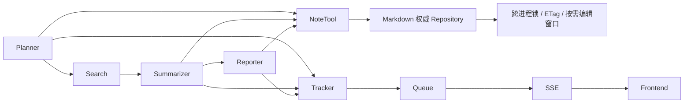
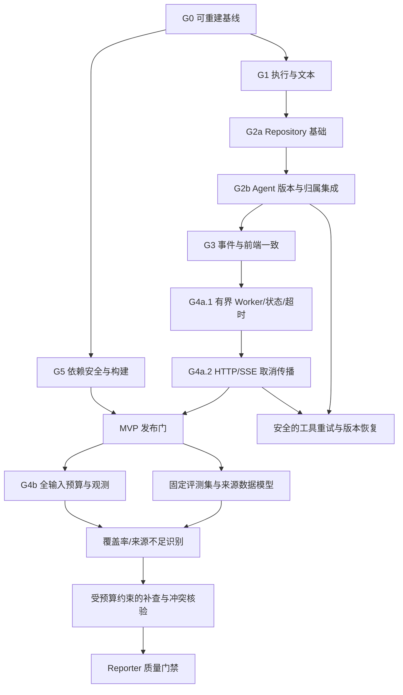

# HelloAgents DeepResearch 最终改造方案

日期：2026-11-02（Asia/Shanghai）。状态：方案已定，尚未实施。

本次仅修订现有方案文档，保持 G0–G6 总体划分与既定范围。业务代码、依赖、锁文件、审计证据和现有笔记均不修改，不执行迁移、安装、提交或推送。以下“新增文件”“接口”“命令”均为下一阶段的实施约定，不能解读为已经实现或已经验收。

## 1. 决策摘要与已确认约束

本方案唯一的问题依据是 [R/docs/deepresearch_code_audit.md](/home/nhzj121/Agent/codex/projects/hello-agents/deep_search/hello-agents-source/docs/deepresearch_code_audit.md) 中的 A01–A19、R01–R07、S01；较早的两份问题推测文档不作为实施依据。

本次确认的产品约束：

1. 单机 WSL/Linux，必须支持多线程、多进程；不以多主机/网络文件系统为验收范围。
2. 必须支持直接手工编辑 Markdown，并在完整保存后的下一次工具读取时立即生效。
3. 手工编辑期间可以暂停该笔记工作区的 Agent 写入；读取仍可进行。
4. 保留 Planner → Search → Summarizer → Reporter、NoteTool 协作和 SSE 的总体结构。
5. 原有笔记目录作为保护源；任何验证、格式处理、故障注入和切换演练都先在临时目录或副本进行，不能就地修改保护源。

**推荐 NoteTool 方案：Markdown 为唯一内容权威，工作区级跨进程文件锁、原子替换、内容 ETag 冲突检测、显式手工编辑暂停机制；实时索引由磁盘派生。** SQLite 权威存储方案保留为备选，不纳入本次推荐实施路线，因为它不能自然满足“任意编辑器直接改 Markdown，下一次读取立即生效”。

**最小可行交付 MVP：G0–G3、G4a、G5。** 它修复全部 A01–A19，补齐取消/并发/资源清理的最低可靠性，并完成 S01 依赖维护验收。G4b 的精细输入预算与长期压力测试、G6 的 Agent 质量提升独立排期，不能用来替代已确认缺陷修复。

阶段里程碑不是自动上线或迁移授权。尤其 G2 通过副本验收，只说明可进入人工切换评审，不意味着可以写入原笔记目录。

## 2. 版本基线与证据规则

- 仓库根目录 R：`/home/nhzj121/Agent/codex/projects/hello-agents/deep_search/hello-agents-source`。
- WSL 发行版：Ubuntu22.04.3；Windows 入口目录不作为代码开发位置。
- P：`R/code/chapter14/helloagents-deepresearch`；B：`P/backend`；F：`P/frontend`。
- 当前提交：`755ae75958e6fb072c8a075bcbc55ad15d98bb17`，main；未拉取远端。
- 本方案复核时，已跟踪文件仍无修改；AGENTS.md 与审计 docs/ 为既有未跟踪内容。实施前应由用户自行保存/提交基线，不把 HEAD 当成已包含审计文件的完整回滚点。
- 审计报告 SHA256：`3c0cc107975642ed610e22a8bdde81230b6d714b4bb8d13a5b91417ef4295881`。
- 已验证环境：backend/.venv，Python 3.12.14、hello-agents 0.2.9；具体依赖和测试结果见 [R/docs/audit_evidence/environment.json](/home/nhzj121/Agent/codex/projects/hello-agents/deep_search/hello-agents-source/docs/audit_evidence/environment.json)、[R/docs/audit_evidence/integrity.json](/home/nhzj121/Agent/codex/projects/hello-agents/deep_search/hello-agents-source/docs/audit_evidence/integrity.json)。
- 首次方案编写记录的 sqlite3 运行时版本为 3.53.1；当时没有创建数据库或操作笔记，本次也不执行数据操作。它不构成 SQLite 方案已实现/已通过并发测试的证据。
- 所有“已确认”沿用审计的复现范围。真实服务商取消、真实后端限流、生产漏洞可利用性仍有原报告列出的验证边界。

正文源码路径是现有修改入口，拟新增路径会明确标注“拟新增”。审计编号是固定追踪键；测试编号 Txx/Fxx 指原审计中的复现，不是改造后的成功标准。

## 3. 三类工作边界

| 类别 | 包含 | 不混入的事项 |
|---|---|---|
| 缺陷修复 | A01–A19 的错误执行、数据覆盖、关联、文本清理、安装和前端状态问题 | 不因代码风格不常见而重写整个 Agent 框架 |
| 工程可靠性 | R01–R07 的取消、并发上限、资源关闭、故障交接、history 清理、输入预算；S01 依赖维护 | 不把客户端断开等同于服务商停止生成/计费 |
| 新增 Agent 能力 | 证据覆盖评估、补查、冲突核验、质量门禁、多轮反思、语义重试/恢复 | 不作为修复同步接口或笔记安全的前提，不宣称原项目已具备 |

保留共享 LLM 客户端和全局 SearchTool 的现有使用方式，保留 Queue 作为事件通道；仅在已复现问题对应的局部添加边界。T22 的并发 MockTransport、T04 的正常事件唯一性和 T26 的后端覆盖/回退继续作为保护测试。不会因“共享对象”“使用线程”“Queue 不够高级”迁移到其他工作流框架或消息中间件。

## 4. NoteTool 两种实施方案比较与最终选择

### 4.1 方案 F：Markdown 权威 + 协作锁与版本校验（推荐）

- 每个笔记文件是权威数据；每次 read/list/search 都重新读取有效文件，不依赖进程内陈旧索引。
- 所有 Agent 创建、更新、删除都进入同一个工作区锁协议。使用进程内工作区锁协调线程，再使用独立打开的固定锁文件和 Linux flock 协调进程；锁顺序固定，存储层只加锁一次；固定锁文件不随数据替换或清理而删除，避免不同进程锁住不同 inode。
- 在锁内读取最新文件、校验 ETag、生成新内容、写同目录临时文件、fsync、原子替换和目录 fsync。锁不跨模型或搜索调用。
- notes_index.json 不再作为在线权威或在线写入目标。MVP 直接扫描文件构建 list/search/summary；保持原有结果数量限制，首先以当前最多约 1000 笔记规模验证性能。旧索引在源目录与副本中保持原样，兼容导出需要时另建新目标。
- 普通手工编辑在无并发写入者时可直接完整保存，read 随即读取新内容；高安全要求、批量或可能与 Agent 写入重叠时使用暂停窗口。ETag/格式检查不能替代未参与锁协议的编辑器并发协调，详见 5.5。

### 4.2 方案 D：SQLite 权威 + Markdown 导出

- 单个事务内维护笔记、唯一 ID、版本和归属；每次操作独立连接，CAS 更新版本，不能共享一个 Python Connection 跨线程随意使用。
- Markdown 是导出物；数据库提交与文件导出不是一个 SQLite 事务，需要 outbox/可重建投影处理导出失败。
- 要使任意编辑器改动立即可见，还必须在每次读取前同步外部 Markdown、更改冲突处理、处理删除和批量索引。这会重新引入双权威协调，不能称“上 SQLite 就解决全部一致性问题”。
- 若未来取消即时手工编辑要求，可重新评估本方案；多主机需要另选服务型数据库，不能把 SQLite WAL 放在网络共享目录。

### 4.3 对比

| 维度 | 方案 F | 方案 D |
|---|---|---|
| Agent 并发创建 | 锁内 UUID + 禁止覆盖已有目标；跨进程验证 | 主键/唯一约束，事务验证 |
| 单笔记更新一致性 | 锁 + 最新读取 + ETag CAS；过期更新显式冲突 | 事务 + version CAS；数据库可保证提交原子性 |
| 笔记与索引一致性 | 在线不持久化第二份权威索引，避免两文件事务 | 笔记/索引可同一事务；Markdown 投影仍需另行协调 |
| 跨多个笔记的原子提交 | MVP 不承诺；不以多个 rename 冒充事务 | 可在单库事务中实现 |
| 手工编辑立即生效 | 原生适配；完整保存后下一次读取即生效 | 导出文件编辑不会自然回写数据库，必须增加同步机制 |
| 旧笔记兼容 | 可在副本中保留 ID、正文及旧格式；无需数据库导入才能读 | 需导入、校验、映射、导出和切换；原 ID 可以保留 |
| 开发复杂度 | 中；难点是锁、版本、原子落盘和编辑窗口 | 不含手工同步时中；满足本次编辑要求后高 |
| 回滚难度 | 较低；新工作区隔离、源目录不动，可直接检查 Markdown | 中高；必须保存 DB 与已提交数据，导出/切回要验证；在线复制主 DB 文件也不足以保证备份完整 |
| 主要限制 | 文件锁是协作式；不约束绕过协议的任意写入者 | 单写事务与外部文件同步复杂度；WAL 有同机文件系统边界 |

SQLite 的事务隔离与单写者特性可用于方案 D，但不能推广为数据库外 Markdown 的事务保证。[SQLite 隔离说明](https://www.sqlite.org/isolation.html)；WAL 的同机要求见 [SQLite WAL 文档](https://www.sqlite.org/wal.html)。在线备份应使用支持一致性快照的方式，不能仅复制正在写的主文件。[SQLite Backup API](https://www.sqlite.org/backup.html)

选择 F 的原因是本次已确认的手工编辑要求与单机 Linux 环境，而非 SQLite 不可靠。F 仅保证协作协议覆盖的 Agent 写入和完成保存后的读取；对未暂停而强行同时写文件、编辑器尚未完成的原地截断保存、不可信进程拥有同一用户权限的任意文件替换，不作“绝不会丢失”的虚假承诺。

## 5. 推荐 NoteTool 存储详细契约（G2，独立高优先级）

### 5.1 文件和组件

保留名为 note 的工具，以及 create/read/update/delete/list/search/summary 动作和主要文本输出。项目内增加适配层，底层替换 unsafe 存储实现，不直接改 .venv/site-packages。

拟新增：

- `B/src/storage/note_repository.py`：数据对象、错误码、Repository 协议。
- `B/src/storage/file_notes.py`：唯一 ID、锁、ETag、读取与原子提交。
- `B/src/storage/note_codec.py`：旧格式兼容和新格式编解码。
- `B/src/storage/manual_edit.py`：跨进程暂停/恢复与验证。
- `B/src/tools/project_note_tool.py`：Tool.run 字符串兼容入口、内部结构化 execute 入口。
- `B/src/services/agent_adapter.py`：组合原版 Agent 的门面与窄 LLM 视图，不复制核心执行流程。
- `B/src/services/note_ownership.py`：当前研究任务/最终报告的可信归属、幂等键。
- `B/scripts/notes_admin.py`：只面向显式指定工作区的检查、编辑窗口、兼容导出；不会自动以 ./notes 为目标。

修改入口：[B/src/agent.py:35](/home/nhzj121/Agent/codex/projects/hello-agents/deep_search/hello-agents-source/code/chapter14/helloagents-deepresearch/backend/src/agent.py:35)、[B/src/services/notes.py:10](/home/nhzj121/Agent/codex/projects/hello-agents/deep_search/hello-agents-source/code/chapter14/helloagents-deepresearch/backend/src/services/notes.py:10)、[B/src/services/tool_events.py:41](/home/nhzj121/Agent/codex/projects/hello-agents/deep_search/hello-agents-source/code/chapter14/helloagents-deepresearch/backend/src/services/tool_events.py:41)、[B/src/config.py:39](/home/nhzj121/Agent/codex/projects/hello-agents/deep_search/hello-agents-source/code/chapter14/helloagents-deepresearch/backend/src/config.py:39)，以及 G2b 的组合式工具适配；G3 负责事件/API/前端投影。现有 notes/ 不作为默认测试或初始化目标。

### 5.2 数据与错误模型

```text
NoteSnapshot:
  id, title, note_type, tags, content, created_at, updated_at
  run_id?, task_id?, purpose?, idempotency_key?
  etag                 # 文件完整字节 SHA256，包含手工编辑造成的变化
  format_version       # 旧文件可以没有，按旧格式读取
  path

NoteWriteResult:
  ok, note_id?, etag?, note_path?
  error_code?, detail?
  persisted: true | false | unknown  # 提交状态三态，不能用字符串表情推断

NoteBinding:
  run_id + task_id/purpose -> note_id
  verified, etag
```

Repository 返回快照或明确异常，工具层转换为结构化结果和原兼容文本；Tracker 使用结构化结果。create 成功仍有单独的 `ID: <id>` 行，保留旧解析兼容；失败不能夹带可被当作成功 ID 的输出。

错误码至少有 INVALID_ID、NOT_FOUND、CONFLICT、READ_REQUIRED、VERSION_PARAM_MISMATCH、WRITES_PAUSED、FORMAT_ERROR、OWNERSHIP_ERROR、IO_ERROR、COMMIT_UNCERTAIN。fsync/replace 之间失败若不能确认持久性，必须报告 COMMIT_UNCERTAIN 并重新校验，不能简单宣称“失败且毫无修改”或盲目重试。

note_type=conclusion 继续表示笔记类型，不等于最终报告归属。purpose=final_report 和可信 run_id 才能用于最终报告幂等定位。

### 5.3 创建和更新的保证

1. 新 ID 使用 `note_<uuid4 hex>`，保留旧 `note_YYYYMMDD_HHMMSS_count` ID；都视为不透明字符串。
2. 在跨进程独占锁内验证目标不存在；碰到人为注入的 UUID 碰撞，重新分配有限次或返回冲突，绝不以 replace 覆盖已有笔记。测试不能仅用概率论替代此断言。
3. Repository.update 必须携带来自读取快照的 expected_etag；Agent 的 note.update 可省略该参数，由组合适配层从当前生成的可信凭据自动注入。缺少有效凭据返回 READ_REQUIRED，不能要求 LLM 手写版本来保证安全，也不能把缺失版本当作允许覆盖；具体绑定见 5.7。
4. 在锁内重新读取最新版本；ETag 不同返回 CONFLICT，文件不变。标题/tags 等 patch 只改显式字段，未提供的字段从最新快照保留。
5. 过期内容更新不自动“换上最新 ETag 重试”，因为旧正文仍可能覆盖新信息。expected_etag 必须绑定产生本次内容时的读取/本次创建快照；最终报告持久化同样不能临提交再读一个新 ETag，为旧模型输出伪造新基线。需要重新读取、重新合并后明确发起更新；MVP 不新增模型自动合并能力。
6. 删除同样校验 ID、归属和版本，至少使用独占锁+unlink+目录 fsync；跨多个笔记的批量事务不属于 MVP。
7. 临时文件与目标在同一 Linux 文件系统；写入返回后能够重新读取并核对版本。启动只清理确定无引用的临时文件，不能自动覆盖坏笔记。

文件内容替换的原子可见性与掉电持久性是不同保证，必须分别测试；相关系统接口见 [Python os.replace/fsync](https://docs.python.org/3.12/library/os.html#os.replace)。Linux 文件锁接口见 [Python fcntl](https://docs.python.org/3.12/library/fcntl.html)。

### 5.4 路径边界（A17）

- 所有动作共用严格的 ID 验证；拒绝绝对路径、/、反斜线、..、NUL、路径型 ID。
- 从经过验证的工作区目录 fd 访问文件；Linux 使用 O_NOFOLLOW 等能力拒绝符号链接，不能只做一次 Path.resolve 检查后再随意重开路径。
- read/update/delete 与 list/search 扫描同样拒绝符号链接；文件名 ID 与 frontmatter ID 必须一致。
- 临时文件和锁文件名由服务生成，用户参数不得指定文件路径；后台配置的 notes_workspace 本身由管理员选择。
- 威胁边界是工具参数和不可信笔记条目，不承诺防御拥有该 Linux 用户全部权限的恶意进程。
- 原有异常/非法条目只能在副本中列入检查报告；不能自动重命名、删除、修复原文件。

### 5.5 手工编辑：普通编辑与高安全窗口

manual-begin/manual-end 保留，作为高安全要求、批量修改、可能与 Agent 写入重叠时的推荐操作方式；不再要求每次小范围编辑都先执行 CLI。这里“无并发写入者”指没有正在运行、排队或收尾且可能提交笔记的 Agent 执行；不能仅凭 UI 暂时空闲或当前没有文件 I/O 判断。

| 场景 | 可采用方式 | 保护与限制 |
|---|---|---|
| 工作区没有并发写入者，例如 Agent 已停止或笔记写入已禁用 | 直接编辑，优先原子保存；完整保存后下一次 read 立即生效 | ETag 使先前快照失效，格式校验拒绝坏元数据；无需额外暂停命令 |
| Agent 的旧 read 之后、CAS 检查之前完成一次手工保存 | 普通编辑可被检测 | ETag 不同则 Agent update 冲突；这只是可检测的一种时序 |
| 编辑器与 Agent 同时保存同一笔记，且要求不丢任一修改 | 使用高安全窗口，或先停止全部 Agent 写入 | ETag + 格式校验不足以保证安全；编辑器没有参加 Repository 的锁/CAS 协议 |
| 非原子保存尚未完成，或批量编辑中间状态 | 高安全窗口降低写覆盖风险；等待保存完成后读取 | 即使暂停 Agent 写入，读取仍可能见到空文件、半文件或格式合法但正文不完整的状态，不能保证中途读取是一致快照 |

必须明确两个剩余竞争：其一，Agent 已比较 ETag 但尚未 replace 时，编辑器可能保存，随后被 Agent 覆盖；其二，编辑器基于旧内容打开文件，Agent 已提交后，编辑器再保存覆盖 Agent。原子保存只解决单次文件替换的可见性，不解决双方的过期修改。多做一次 stat/hash、格式检查或加 watcher 都不能消除这些竞争；格式正确也不证明正文保存完整。普通并发编辑因此属于低保证用法，不计作“无丢失并发更新”的验收通过。

高安全窗口拟提供：

```text
notes_admin.py manual-begin --workspace <显式工作区>
  -> 等待当前 Agent 提交结束
  -> 在锁内持久化暂停标记、session_token、generation
  -> 返回 token；以后所有 Agent 写入均返回 WRITES_PAUSED

notes_admin.py manual-end --workspace <工作区> --token <token>
  -> 用户已完成保存后，在锁内校验所有有效笔记、ID/路径、编码和格式
  -> 通过后记录新 generation 并移除暂停标记
  -> 失败则保持暂停，不改坏笔记，不自动强制恢复

notes_admin.py inspect --workspace <工作区>
  -> 只读列出问题与当前是否暂停
```

read 始终读取磁盘，不依赖 watcher/polling 或内容缓存。对于非原子保存，解析失败明确报错，不重建覆盖文件；对格式合法的部分正文不能谎称能够可靠检测。用户在完整保存后触发读取才属于即时生效保证。

暂停标记在后端退出/重启后仍有效，不因 PID 消失或超时自动恢复写入。恢复需要显式 token/管理员恢复流程和格式验证。手工编辑不要改 ID 与归属字段；管理这些字段仍先在副本验证。

模型调用可在窗口中继续计算，但工具写入被拒绝；恢复后使用生成时冻结的旧 ETag，内容变化即冲突，不能刷新版本后继续覆盖。manual-begin 成功返回前已经进行的 Agent 提交必须先结束。本修订仅明确使用边界，不增加自动合并、编辑器插件或新的编辑模式开关。

文件锁/替换接口边界参见 [Python fcntl](https://docs.python.org/3.12/library/fcntl.html#fcntl.flock) 与 [os.replace](https://docs.python.org/3.12/library/os.html#os.replace)。

### 5.6 旧笔记和索引兼容

- 旧文件由原 NoteTool 生成，其 title 可能含未转义冒号；不能直接把全部旧 frontmatter 当作严格 YAML 解析，再声称兼容。
- codec 对没有新 format_version 的旧文件走明确的旧格式兼容读取，保留 ID、正文、tags、时间和未知字段；新文件使用明确版本的安全编解码。新版本 codec 选用 PyYAML 的 safe_load/safe_dump；将已经存在于 uv.lock 的 PyYAML 6.0.3 声明为直接依赖，G0/G2 验证后再锁定，不依赖偶然的传递安装；旧格式仍使用专用兼容分支，不强行套用严格 YAML。[PyYAML 安全加载说明](https://pyyaml.org/wiki/PyYAMLDocumentation)
- 无法无损解析的条目阻止切换，输出副本检查结果；MVP 不自动猜测正文/元数据，不把原数据标成已修复。
- 在线读取不写回旧文件、不自动规范化旧笔记，不因缺失 notes_index.json 初始化一份权威索引。
- 用户可见变化：新 note_id 格式、冲突/暂停错误，以及新运行工作区的绝对 note_path。旧 ID 在副本中保持，Markdown 仍可手工查看编辑。
- 历史索引中已有重复 ID、孤儿文件或漏项只能检测，无法从被覆盖的内容自动恢复丢失数据；方案不承诺找回审计前已丢失的版本。

### 5.7 ETag 与 Agent 的可信绑定（G2b）

Repository 的 expected_etag 是必填的低层 CAS 条件；LLM 工具参数中的 expected_etag 不是可信来源。项目适配层管理读取凭据，模型可以不填写版本；若填写与可信凭据不一致的值则拒绝，不以该值覆盖服务端基线。

```text
ReadReceipt（不可变，服务端生成）:
  receipt_id, execution_id, run_id, agent_scope, task_id/purpose, note_id
  etag, snapshot_digest, tool_execution_id

GenerationBasis（一次模型生成的冻结快照）:
  generation_id
  note_id -> 已向该次生成提供完整笔记快照的 ReadReceipt

NoteBinding / SSE 的 note_etag:
  仅供关联与展示；不是后续 update 的版本授权
```

绑定流程：

1. 当前 Agent 的 note.read 从 Repository 得到完整快照；工具视图登记 ReadReceipt，并在正常工具结果文本中返回笔记内容、ETag 和不透明 receipt_id。凭据保存在该 execution 的内存 ledger 中，不能存进共享工具的 current_etag 字段。fresh create 若返回完整已提交快照，也可登记同类凭据；只有 ID 的 create 回执不能登记，且完整 create 快照也必须经下一次模型输入交付后才生效。
2. 组合适配层的窄 LLM 视图在每次 invoke/stream_invoke 开始时，用上游实际传入的 messages 与本 execution 的可信工具结果记录匹配，确认哪些读取结果已包含在这次模型输入中；只将这些凭据冻结为 GenerationBasis。不能仅扫描任意文本里的 ETag/receipt_id 就承认其来源。
3. 该次生成结束后，upstream Agent 解析并执行它产出的 update。冻结基线保留到下一次模型调用开始或 execution 结束，不能在 stream_invoke 正常耗尽时就清空，否则其后工具批次将失去基线。note 工具视图按 execution、当前 generation、note_id 与可信任务/用途找到冻结基线，自动向 Repository 注入其 etag。没有已交付的完整 read 快照，返回 READ_REQUIRED，不读取最新版本补齐。
4. Repository 在锁内读取当前磁盘字节只是为了比较 CAS 条件；它不能把当前 etag 反向写成 expected_etag。参数来自同一次内容生成的基线，不来自临提交新读取。
5. 同一段模型回答内的 read→update 是特殊必测场景：read 执行时，这个 update 的正文已经生成。read 得到的新凭据只登记为待交付，不得更改本轮冻结基线；无旧基线则 update 拒绝，有旧基线则仍按旧版本检测。只有下一次模型调用实际收到 read 结果后，新的基线才可用于它新生成的 update。
6. update 成功后不能让同一回答中的第二次 update 自动使用返回的新 ETag。写入确认不是新的内容读取；失败、CONFLICT、COMMIT_UNCERTAIN 也不授予新基线。成功写入或版本不确定/冲突后撤销该笔记已有写入凭据，后续修改需明确 read 并经下一次生成；MVP 不自动重发模型请求、不增加上游工具迭代上限。
7. list/search 的摘要、错误输出、Tracker 回填的最新版本不授予写入凭据。复用 Agent、不同任务、不同 run 的凭据不能互相借用；异常或结束时清理 ledger，生成产物需要的基线以不可变副本单独传出。

最终报告使用内部 `GeneratedText(text, generation_id, read_basis)` 将正文和生成基线一起交给 ReportingService/_persist_final_report，不能再从“当前绑定里最新的 etag”取版本。目标不存在时可 create-if-absent；若幂等键已存在但正文没有对应生成基线，则返回 READ_REQUIRED/CONFLICT，不能读到最新版后直接覆盖。普通 create 的 ID 回执或仅返回 ID 的幂等命中也不等同完整 read 授权；只有返回完整快照并按第 1–2 条交付，才可形成下一次生成基线，否则仍需 read。

该机制只保证版本与模型获知的快照绑定，不声称模型在语义上正确理解或合并内容。它不改变外部 HTTP/SSE 字段，也不引入持久化凭据或新的 Agent 推理能力。

## 6. 既有笔记保护、切换与数据回滚

保护源为当前实际 notes_workspace 指向的旧目录；实施时先确认配置，不能假设一定是 backend/notes。测试不得继承真实环境中的该路径。

切换流程（仅计划）：

1. 所有写入者进入维护状态，取得一致的只读源快照；复制到独立目录，记录文件清单、ID、哈希和原索引。复制不能改源目录权限、mtime 或内容。
2. 用副本跑旧格式读取、并发测试、路径拒绝、手工编辑、版本冲突、崩溃恢复和兼容导出演练；保护源不参与故障注入。
3. 创建独立运行目录，例如 backend/notes-v2；源目录保留不动。先用独立临时目标导入/复制验证后的数据，验收通过后才把配置切到新目标。新目标不能是源目录的别名、父子嵌套目录或符号链接。
4. 对比 ID/正文和可解释元数据差异；所有差异有报告。切换只是配置指针和新版本服务的切换，不进行源目录原地迁移。
5. 新工具从第一次写入起接管整个新工作区，禁止旧 NoteTool 同时写新工作区；notes-v2、控制标记和临时文件纳入 .gitignore，不能把运行数据加入提交。
6. 手工编辑也只针对新的运行目录，并遵循 5.5 的分级策略；与活跃 Agent 写入重叠且要求不丢修改时使用编辑窗口。

回滚分两种：

- **新目录尚无写入：** 停止新服务，保留验证材料，切回已验证旧版本和原配置；先确认不会恢复原来的并发不安全写入。
- **新目录已有写入：** 先停写并保留新目录完整副本。回滚到上一安全版本时继续读取同一个兼容数据格式；若只能退到原版，则默认 ENABLE_NOTES=false，以降级方式继续研究，新增数据保留供离线导出。不得把旧快照覆盖到新目录，也不得自动合并回保护源。

如确需原版兼容 notes_index.json，拟新增 export-legacy 命令只写空的新导出目标；从 Markdown 扫描生成索引并验证可读性。该目标不是自动恢复原版并发写入的许可证。不能为了“回滚方便”重新启用已经确认不安全的原 NoteTool 写路径。

## 7. 执行、事件和 API 契约

### 7.1 保留的业务关系



run() 首先以显式消费任务生成器修复 A01，不先拆掉整个事件机制。同步任务级异常采用与 Worker 一致的 failed/partial 规则；规划或报告等研究级致命异常仍走 HTTP/SSE 错误出口。总结 Agent 继续每任务独立创建，LLM 客户端继续共享，SearchTool 的 backend 覆盖与 advanced 回退顺序保持。Reporter 继续汇总任务总结与笔记，不在 MVP 增加重新抓网页能力。

### 7.2 数据结构增量

| 结构/入口 | 计划增量 | 兼容与用户可见行为 |
|---|---|---|
| SummaryState | run_id、run_status、可信 TaskNoteBindings、取消上下文引用 | run_id 为本次执行标识，不承诺持久化恢复；每次 run 新建，不沿用旧 Tracker；同一 Agent 实例在旧任务收尾完成前拒绝重入 |
| TodoItem | error_code/detail、note_status、note_error、note_etag；status 统一终态 | 保留已有字段；summary 成功不因笔记失败被隐藏，UI 同时显示“总结完成/笔记失败” |
| ToolCallEvent | success、error_code、run_id、stage、可信 task_id、note_etag | 保留 event_id 为整数和 result 文本；锁内分配 ID 并 append |
| NoteTool | 文本动作兼容；内部 execute 返回 NoteWriteResult；Repository.update 强制版本，Agent 工具视图自动注入 | LLM 可不填 ETag；无可信读取凭据明确 READ_REQUIRED，不再从 ID/表情推定成功 |
| /research 请求 | topic/search_api 不变 | 研究准入达到上限时可在执行前返回 429；正常响应仍有 report_markdown/todo_items |
| /research 响应 | 可选 run_id/run_status/warnings，任务可选 note_status/detail | 增量字段；旧调用方可忽略，但新前端才能表达全部失败/降级语义 |
| SSE | 保留 status/todo_list/task_status/sources/task_summary_chunk/tool_call/report_note/final_report/done/error | 新增可选 run_id、阶段、success、错误与 run_status，不重命名既有 type |
| note_path | 仅返回实际存在且已验证的 Markdown 路径 | 新工作区路径会改变；失败不编造路径，不用 SQLite URI 伪装成文件 |

配置侧拟新增 notes_storage=files_v2 与受保护源目录清单。启用 files_v2 时必须显式指定已验证的新 notes_workspace；缺失或指向保护源及其父子目录时启动配置检查失败，不自动沿用旧默认 ./notes 创建控制文件。ENABLE_NOTES=false 仍可用于安全降级。上述设置属于服务配置，不由模型或 HTTP topic 指定。

stage 由执行上下文绑定为 planner/summarizer/reporter/final_persist，不能由模型任意指定。task_id 优先来自当前总结 Worker 绑定的不可变上下文；read 仅有 note_id 时可由已验证映射解析。Planner 在 TodoItem 产生前的记录先暂存，最终任务存在后再验证候选归属；不确定就保持未关联，不用标题片段强行回填。

ProjectToolAwareAgent 是组合式门面，版本与工具结果通过每 Agent 的局部视图传递；不继承重写核心 run/stream_run。具体实现、例外门禁与回归见 7.2.1，版本凭据见 5.7。

### 7.2.1 ProjectToolAwareAgent：组合式适配边界

名称保留为项目门面，不表示必须继承 ToolAwareSimpleAgent。拟在 `B/src/services/agent_adapter.py` 中组合一个**原版、未覆写 run/stream_run 的** HelloAgents ToolAwareSimpleAgent，构造时注入每 Agent 的工具视图、窄 LLM 视图和监听器。共享的底层 LLM 客户端、Repository 和 SearchTool 保持，隔离的是 execution/receipt 状态。

| 组合点 | 允许职责 | 禁止职责 |
|---|---|---|
| 门面 run/stream_run | 各调用一次上游对应入口；作用域、同实例重入保护、finally 清理、正常返回/逐片转发 | 自己重写 messages 循环、工具解析/调度、迭代计数、fallback 或 history 算法 |
| note 工具视图 | 结构化执行、可信 task/purpose、版本自动注入；返回原字符串协议 | 从 LLM 参数或展示缓存接受新写入版本；修改共享工具上下文字段 |
| 窄 LLM 视图 | 在原调用前冻结 GenerationBasis，原样委托 invoke/stream_invoke 与参数；记录返回正文所属 generation | 另发模型请求、修改工具迭代次数、改消息内容或把所有共享客户端改成独立实例 |
| 工具结果 journal + 监听器 | 以当前 execution/tool_execution_id 对应结构化结果并记录一次事件；解析失败明确失败 | 从 ❌/ID 字符串猜 success；同一调用既直接 record 又在监听器重复 record |
| 生成产物 | 内部方法返回 GeneratedText；兼容门面 run 仍可返回 str | 把可变的“最后一次 etag”当作所有输出的版本 |

当前 0.2.9 已有这些组合入口：SimpleAgent.run 在调用 llm.invoke 后执行本轮工具，再把结果放进下一次 messages（simple_agent.py:283–317）；ToolAwareSimpleAgent.stream_run 同样先消费本轮流，再执行工具并回填结果（tool_aware_agent.py:361–417）；_execute_tool_call 调用 tool.run 后触发 listener（第 75–102 行）。因此无需复制核心流程，也无需为 ETag 重写 run/stream_run。

工具视图把 NoteWriteResult 写入 execution 局部 journal，随后注入的 listener 取出对应结果；一轮多个工具、失败与缺少 journal 的路径都必须验证。关联不确定时按适配错误处理，不能退回字符串猜测并回填 ID。普通未知工具不触发 listener 等上游既有边界不借此扩大为“拦截一切工具尝试”的新功能。

流式门面和 LLM 视图在关闭/异常时关闭自己持有的本次迭代器并清理 ledger；这不等于保证底层 SDK response 已关闭，R04 仍按 G4a.1 的资源测试单独验收，不能顺便复制上游 Agent 流程来规避。

**继承例外门禁：** 当前没有采用继承覆写的必要。实施中只有测试证明现有 tool/LLM/listener 组合钩子确实无法可靠关联某个必要行为，才可提出局部方法覆写；必须记录失败复现、不能用组合解决的原因、最小方法范围与版本依赖。run/stream_run 整体复制不作为默认备选；本次未授权实施该例外。

G2b 回归至少包含：门面恰好委托一次上游入口；同步/流式工具轮次、fallback、参数、片段顺序与 T24 的执行时机一致；正常 history 两条、异常清理；多工具结构化结果不串位/不重复；不同 Agent 并发凭据隔离；同一回答 read→update 不被新 ETag 提权；新增组合层没有额外模型调用。

### 7.3 任务、笔记和研究状态分开

- 任务：pending → in_progress → completed/skipped/failed/cancelled；终态不能被迟到事件改回进行中或已完成。
- 笔记：disabled/not_started/saved/error/conflict/paused。saved 必须对应真实提交和已校验 ID。
- 研究：running/completed/partial/failed/cancelled；done 只表示正常协议流结束，不等于全部任务成功。
- 任务失败时对象、SSE、Reporter 输入必须一致。部分任务失败仍可输出报告，但 run_status=partial；全部任务未成功则不能以 completed 标注流程，报告文本不自动当成已验证事实。
- 笔记失败不抹去研究总结；把警告和 note_status 明确给用户。MVP 不因此自动增加一次模型修复调用。

最终报告笔记必须由可信 run_id + purpose=final_report 定位，拒绝 task_state 或普通 conclusion 候选。Reporter 重复调用 final_report create 时由 NoteTool 适配层按同一幂等键返回已有 ID；_persist_final_report 更新同一记录，不另建，不扫描标题猜测。Reporter 使用绑定 run_id/purpose=final_report 的工具视图，报告 create 只能命中该研究的幂等键；其他阶段创建的普通 conclusion 不自动升级为最终报告，不能覆盖任务笔记。幂等键定位通过锁内扫描受验证笔记元数据完成，不引入另一份未经事务协调的权威索引。

### 7.4 事件交接与前端终止

- 保留 record + drain + 即时 sink，先修已确认 ID/关联。R03 必须先写 sink/start/关闭交接故障测试；只在约定保证被测试证实不满足时增加局部 delivery 状态与补发，若现有路径已通过则保留实现。目标是只有 enqueue 成功才标记已送达，单一消费者负责归属回填，不在 callback 内递归 drain。
- sink 指针与交接状态受同一锁保护，callback 在锁外执行；sink 关闭前先停止/确认正常生产者。失败回调保留待补发事件；用 run_id+event_id 去重，不能用不唯一标题去重。
- 正常流保持每任务完成标记；加入线程启动失败、callback 失败、取消和终止交接测试。只对失败边界改动，不把未发生的正常丢事件当理由重写 Queue。本轮不设计持久化回放；入队唯一性和前端幂等不等于网络端到端恰好一次交付。
- 前端按请求身份隔离 onEvent/catch/finally；旧请求不得更新新请求 loading/error/report/tasks。
- 未有 todo_list 的 Planner 工具事件暂存；任务列表到达后关联并去重。
- JSON 解析异常与 UI callback 异常分开传播；遇到终止帧释放 reader。EOF 前没有合法 done/error 属于协议失败。
- completed/skipped/failed/cancelled 均显示中文状态；failed.detail 进入任务错误。进度同时显示成功数与已终结数，避免 skipped 的语义争议。
- MVP 保证现有后端的单行 JSON、LF SSE；保持 UTF-8 任意字节切分测试。CRLF/完整 SSE 通用兼容可小步补齐，但不声称当前协议对本地 LF 已损坏。

### 7.5 文本清理与关闭

统一同步/流式思考过滤语义：

- 完整 <think>…</think> 区段不输出；起止标签的每种 chunk 分割都要覆盖。
- 尚未完成的标签前缀保留在有界解析缓冲中；未闭合思考块不刷新为可见正文。
- 孤立 </think> 作为畸形标签丢弃并记录诊断；反向标签、嵌套标签必须保证扫描前进并终止，不进入无限 while。
- finally 不 yield；正常结束才 flush。任何退出路径关闭本次内层生成器/响应并 clear_history。
- 工具标记清理使用支持嵌套数组、字符串和转义的 parser；可复用并加测试，不能用更贪婪正则跨多段删除正文。
- Planner/Reporter 的 history 清理移到 finally，但不宣称此前首轮异常已经造成跨请求历史泄漏。

## 8. 工程可靠性边界（R01–R07）

### 8.1 G4a：MVP 的取消、限流和资源生命周期

拟新增 `services/execution_control.py`、`llm/project_llm.py`、`services/search_runtime.py`，修改 main.py、agent.py、config.py、summarizer.py。范围仅为 R01/R02/R04 的明确行为缺口，继续使用原 LLM/SearchTool 业务接口与 Queue。

**G4a 分两步，顺序固定：**

- **G4a.1 执行层先行：** 先实现有界 Worker/研究准入、统一状态、单调时钟 deadline、显式 I/O timeout/有界重试和每次响应释放；沿用当前 HTTP/SSE 接入，不先改异步桥接。内部 ExecutionControl 的协作检查点可以先用直接 Event/假时钟验证，但本步不宣称浏览器断连已传播。
- **G4a.2 传输层后接：** 在 G4a.1 独立验收后，main.py 才增加可响应 disconnect 的异步 SSE 桥接层，处理 ASGI 断开/发送错误、请求生成器关闭、控制信号传递与迟到事件。两部分都通过才可宣布 G4a 完成。

下面的边界适用于最终两步集成结果，不能把它们作为第一步已经具备的能力：

建议初始配置（是方案默认值，不是假定服务商配额）：

| 配置 | 初始值/语义 |
|---|---|
| MAX_TASK_WORKERS | 每研究 3；保留完整任务列表，调度池限并发 |
| MAX_ACTIVE_RESEARCH | 每服务进程 2；超出在 HTTP/SSE 开始前明确拒绝，不创建无限等待队列 |
| MAX_PLANNED_TASKS | 每研究 8；模型超量输出明确规划失败，不静默裁掉已展示的任务 |
| RESEARCH_DEADLINE_SECONDS | 180，使用单调时钟，停止新阶段/新调用的协作截止时间 |
| MODEL_CONNECT/READ_TIMEOUT | 5/20 秒，作为初始 I/O 配置；不是严格的请求总耗时保证 |
| CANCEL_POLL_INTERVAL | G4a.2 的本地断开检查目标 <=0.2 秒；G4a.1 不启用传输轮询，测试用 Fake 时钟/可控事件 |

多 Uvicorn 进程的容量为进程数乘以上述每进程上限，不宣称是全机 2 个研究。部署清单必须记录 worker 数；真正的全机/租户配额不属于 MVP，不能因增加 worker 而忽略服务商限额。

- 每研究有取消 Event、deadline 和执行身份。main.py 用可响应 disconnect 的异步 SSE 桥接层消费研究事件；阻塞研究代码继续在受管理线程运行，不在事件循环直接调用同步搜索或模型。
- 取消先停止新任务/新阶段，标记未终结任务，禁止后续报告生成和笔记提交。工具提交与取消接受使用同一研究控制锁定义先后关系：接受取消前已提交的内容保留，之后的新提交拒绝。
- 在模型轮次、工具执行、搜索结果处理和每个可见流片段的边界检查控制上下文。NoteTool 在存储提交前检查，不能只在调用 LLM 前检查一次。
- 已在同步 HTTP 中等待的请求可能继续到返回或 I/O 超时；deadline 和 Event 无法强杀线程。MVP 不承诺提供方立刻停止计费。SDK 重试须有界且受剩余预算控制，不能让默认重试悄悄无限延长收尾。
- 显式关闭的是本次 SDK response/stream；不因一个 Worker 取消而关闭其他 Worker 共用的整个 LLM 客户端。
- 不再在请求关闭路径无期限 join；执行监督器继续持有未结束任务及其容量配额，直到实际退出。不能提前释放配额后任由旧线程堆积。
- 浏览器 Abort 后没有后端确认通道：前端显示“连接已取消，后台可能仍在收尾”，不能显示“API 费用已停止”。服务端 deadline 触发且连接仍在时可发送 cancelled 终态。
- DDGS 内部未完成 futures 和第三方实际取消能力仍须观测。只有测试证明需要时才做受控后端适配；不为此整体更换全局 SearchTool。需要强制进程隔离/硬截止时间时另立可靠性增强项，不伪装成现有线程模型已具备。

### 8.2 G4b：后续工程增强，不是 Agent 新能力

R06 增加明确的 per-task 与 Reporter 输入预算，分别计入 snippet、raw_content、answer、提示与工具结果；保留来源标识和截断提示，不能只限制 raw_content 后宣称总预算已控制。初版可声明字符预算，真实 Token 硬限制必须使用对应模型 tokenizer/服务能力并验证，不能继续把中文按 4 字符/token 当准确值。

增加真实 SDK 的慢响应/429/超时、连接数与线程数长时观测，验证 R03/R04 边界。性能测试只使用受控服务或明确授权的预算；共享客户端/搜索对象没有串扰证据时继续保留。

R07 的报告幂等安排在 G2b/G3 实施；不要等新增语义重试后才保护报告归属。R05 的 finally 清理放在 G1，成本小，不必独立架构重构。

## 9. 分阶段实施、验收与回滚

### 9.1 命令约定与测试状态

本轮不会新增或运行改造后的测试实现。下列 acceptance 文件是各实施阶段必须交付的文件，当前尚不存在；表中的命令在该阶段实现提交内应当可以直接运行，禁止以空测试文件、被 skip 的测试或 ImportError 充当通过。

所有 Python acceptance 使用 stdlib unittest，前端复用已安装 TypeScript/Vue 与 Node；默认 Fake LLM/Search、禁止收费外连，不为验证自动安装依赖。每个测试显式注入 TemporaryDirectory；多进程用 spawn，在各进程独立构建 Repository。B/src 作为测试导入路径，不继承真实 NOTES_WORKSPACE。

在 WSL 中使用统一前置：

```bash
cd /home/nhzj121/Agent/codex/projects/hello-agents/deep_search/hello-agents-source
test "$(uname -s)" = "Linux" || exit 1
printf 'WSL registration name=%s\n' "${WSL_DISTRO_NAME:-native-linux}"
if test -r /etc/os-release; then
  ( . /etc/os-release; printf 'OS ID=%s VERSION_ID=%s\n' "$ID" "$VERSION_ID" )
fi
test "$(git rev-parse --show-toplevel)" = "$PWD" || exit 1
PLAN_PROJECT_ROOT="$PWD"
PLAN_BACKEND="$PLAN_PROJECT_ROOT/code/chapter14/helloagents-deepresearch/backend"
PLAN_FRONTEND="$PLAN_PROJECT_ROOT/code/chapter14/helloagents-deepresearch/frontend"
PLAN_PY="$PLAN_BACKEND/.venv/bin/python"
PLAN_NODE="/home/nhzj121/.nvm/versions/node/v24.15.0/bin/node"
```

原审计的 `"$PLAN_PY" -B docs/audit_repro.py`、`"$PLAN_NODE" docs/audit_frontend.mjs`、`"$PLAN_PY" -B docs/audit_build_probe.py` 是**当前缺陷复现**。修复后其中某些断言应不再成立；不能要求它们原封不动全部继续通过，也不能直接删掉原始证据。各阶段在新 acceptance 测试中改为断言正确结果，并保留审计文件不变。

### 9.2 阶段总览

| 阶段/类别 | 依据与内容 | 主要文件/结构 | 用户可见变化 | 通过条件 | 回滚边界 |
|---|---|---|---|---|---|
| G0 可重建基线 | A15/A16；测试工具与依赖闭合 | pyproject.toml、uv.lock、后端 README；测试配置 | 正确安装；原启动入口保留 | 干净隔离环境构建/启动成功 | 切回旧环境/构建产物，原 .venv 不动 |
| G1 核心缺陷 | A01/A02/A03/A04/A11/A19，R05 | agent.py、utils.py、planner/summarizer/reporter/text_processing，拟新增 text parser | 同步接口真实执行；失败与文本行为纠正 | 正确结果断言和生成器关闭测试通过 | 回到上一版本；只在临时工作区验证 |
| G2 独立高优先级（G2a→G2b） | 先 Repository 基础，再 Agent 版本/归属集成；A06/A07/A17 与 A08/A10/R07 | G2a storage/codec/manual_edit；G2b ProjectNoteTool/agent_adapter/note_ownership | UUID、冲突、按需编辑窗口、可信版本注入 | 两部分各自验收、兼容/回滚完成才通过 G2 | 回退集成仍保留安全 Repository；不回到原 unsafe 写入 |
| G3 事件/API/前端闭环 | A05/A08/A09/A10/A12/A13/A14/A18，R03/R07 | tool_events、既有适配结果的事件投影、models、main、notes/reporter/prompts、api.ts、App.vue | 正确任务/笔记状态、错误、终止与旧请求隔离 | 全链路 Fake + 前端源码检查通过 | 回滚成套前后端，不回滚新数据覆盖旧数据 |
| G4a MVP 可靠性（G4a.1→G4a.2） | 先有界执行/状态/超时，再 HTTP/SSE 取消传播；R01/R02/R04 | .1 execution_control/project_llm/执行调度；.2 main 异步桥接与断连接线 | .1 容量/超时；.2 明确取消收尾，不承诺强停网络 | 两部分独立验收、兼容/回滚；不以断连测试代替执行层测试 | .2 可独立退回原传输语义，保留已验证 .1 和 G2 |
| G4b 后续工程 | R06，R03/R04 扩展故障与长时观测 | context_budget、search/reporter、观测与测试 | 明确截断/预算提示 | 预算与慢服务测试，不丢来源身份 | 独立开关关闭预算策略，保留核心安全层 |
| G5 安全维护/发布门 | S01 | package.json、package-lock、必要工具配置与部署说明 | 维护依赖；原则上业务交互不变 | 安装/类型/构建/协议回归/再次 audit | 切回已保存的整套锁和前端产物，暴露风险不得静默恢复 |
| G6 Agent 新能力 | 质量提升，非 A/R 原缺陷 | 独立评测与后续研究服务 | 补查、核验、研究质量反馈等 | 先定义基线与预算再实验 | 按能力开关回到 MVP，不动笔记安全层 |

G2a Repository 与 G2b Agent 集成各有独立验收和回滚门，不能因 G1 或仅 G2a 完成就恢复真实笔记写入。G0/G1 可准备，但 G2 验收前测试与试运行使用临时目录或禁用笔记。S01 若对应暴露条件成立应提前处理，G5 不必等全部功能完成才开始准备。

### 9.3 G0：安装与环境

注册名、系统版本、运行能力分开检查：WSL_DISTRO_NAME 是可自定义的 WSL 注册发行版名称；当前调用用 wsl.exe -d Ubuntu22.04.3 选择已确认目标，不把这个名称当作 Ubuntu VERSION_ID。系统 ID/VERSION_ID 从 /etc/os-release 记录，WSL 1/2 信息从 Windows 侧 wsl.exe --list --verbose 记录；G0 兼容性按 Linux/Python 与所需文件系统能力判断。[Microsoft WSL 命令说明](https://learn.microsoft.com/en-us/windows/wsl/basic-commands#list-installed-linux-distributions)

**选定做法：** MVP 保留当前平铺模块和 services 包，修正 setuptools 的 py-modules/包发现，避免把 src/src 当包路径；自动发现 services 及后续 storage/tools/llm 包，并在各阶段重跑 wheel 内容检查；补后端 README，并兼容既有 main:app/--app-dir src 启动。标准命名包布局以后再评估，不在本次同时搬目录。

huggingface_hub 用当前已运行环境的版本作为兼容候选，在隔离环境完成完整锁定/导入测试；不盲目安装 hello-agents[evaluation]。Note codec 使用 PyYAML，补直接声明，保持已审计锁版本优先，实际兼容以新环境测试为准。

拟交付 `tests/acceptance/test_phase_0_environment.py`：

- 构建 wheel 不再报 src/src；检查包含全部平铺模块及 services，而非“构建不报错但漏包”。
- 从 wheel 安装到新的临时虚拟环境，普通 import main/agent/hello_agents 成功，不借用开发 .venv 或源码 PYTHONPATH。
- 使用 Fake 依赖跑 /healthz 与两个研究入口的 smoke；无 API key 也不发真实请求。
- 检查 pyproject/lock 与实际依赖闭合，分别记录注册发行版名、/etc/os-release、WSL 版本、Python/SQLite/Node/包管理器版本；绝不比较 WSL_DISTRO_NAME 与 Ubuntu 系统版本字符串。
- 在 TemporaryDirectory 验证 flock、dir_fd/O_NOFOLLOW、同文件系统 replace 和目录 fsync 能力。用 mock 证明注册名 research-dev 与系统 VERSION_ID=22.04 可以正常通过能力检查，名称相似但能力缺失则失败。旧审计脚本的固定实验注册名不作为新 G0 的兼容门槛，不改动历史复现文件。
- 构建/install 需要新依赖时，在实施阶段的隔离环境中按已确认范围执行；当前方案阶段不执行。

验收命令（实施后）：`PYTHONPATH="$PLAN_BACKEND/src" "$PLAN_PY" -B -m unittest discover -s tests/acceptance -p 'test_phase_0*.py' -v`。测试负责临时 wheel/venv，安装失败不能退回开发环境冒充通过。

回滚：保留旧 .venv 和旧前端 node_modules；新环境采用独立目录，切回旧解释器/产物即可。不要在原 .venv 反复卸装作为回滚。

### 9.4 G1：核心执行和文本

拟交付 `tests/acceptance/test_phase_1_core.py`：

| 场景 | 原证据 | 修复后必须断言 |
|---|---|---|
| 同步单/多任务、fallback | T01 | 每个有效任务确实调用搜索/总结，状态与返回一致 |
| 搜索/总结抛异常 | T02 | TodoItem、SSE 与 Reporter prompt 同为 failed |
| 标签每个可能切分、未闭合、反向/嵌套 | T10/T30 | 无 SECRET 泄漏；有限时间返回；同步流式语义一致 |
| 部分消费后 close、内层流异常 | T11；底层 SDK 的 T23 在 G4a.1 验收 | 不再 yield，清理本层拥有的迭代器，原异常不被遮盖；不借此重写上游 Agent 流程 |
| 参数含嵌套数组、转义与多个工具标记 | T13 | 正文保留，工具参数碎片为零 |
| Planner/Reporter 失败 | T12 | finally 清理执行，不把“清理未调用”扩大成历史泄漏声明 |

命令：`PYTHONPATH="$PLAN_BACKEND/src" "$PLAN_PY" -B -m unittest discover -s tests/acceptance -p 'test_phase_1*.py' -v`。畸形文本时限测试仍用独立子进程；输入构造不允许卡住整套测试。

回滚：这一阶段不更改数据格式；切回上一代码产物。在 G2 之前只允许临时笔记或 ENABLE_NOTES=false，不能用回滚把旧的并发笔记写入重新接入真实数据。

### 9.5 G2：先 Repository，再 Agent 集成

G2a 和 G2b 都属于原 G2，不增加顶层阶段；先通过 G2a，再进入 G2b。G3 保留事件/API/前端联调，不代替后端版本绑定验收。

#### G2a Repository 基础：独立验收

范围：`storage/note_repository.py`、`file_notes.py`、`note_codec.py`、`manual_edit.py` 和相应 notes_admin 管理入口。先完成文件锁、原子写入、低层 expected_etag 校验、ID/路径边界、旧格式兼容、派生索引及编辑窗口。不得为通过本部分测试加载 Agent、LLM、Tracker 或先实现笔记业务归属。

拟交付 `tests/acceptance/test_phase_2a_repository.py`、`test_phase_2a_processes.py`：

- 独立场景：同秒 20 线程各创建一条应得到 20 条；4 个 spawn 进程各创建 25 条应得到 100 条。唯一 ID 数与文件数正确，固定 UUID 碰撞不覆盖。
- 两个 Repository 实例并发更新：旧 ETag 只能成功一次，另一调用 CONFLICT；明确重新 read 并提交字段 patch 后两字段保留。低层缺少 expected_etag 必须失败。
- list/search/summary 与磁盘一致；删除副本索引仍可完整读取，不初始化或重写权威索引。
- ../、绝对路径、反斜线、NUL、symlink、文件名/frontmatter ID 不一致被拒绝；外部目标也只放在临时目录，字节不变。
- 旧格式含冒号标题、Unicode、JSON tags、未知字段、孤儿索引和重复 ID：正确读取或明确阻塞，不静默修复。
- 写临时文件、fsync、replace 各边界故障/终止子进程：只出现旧完整或新完整文件，不出现半文件；COMMIT_UNCERTAIN 不被当作确定失败重试。
- 普通编辑用例：完整保存后长期存活实例的 read 立即返回新内容，旧 ETag 冲突；非原子坏格式明确报错；用可控屏障展示“CAS 检查后编辑”的剩余竞争，不把它包装成已经被修复。
- manual-begin 后其他进程写入拒绝；重启仍暂停；manual-end 遇无效格式保持暂停；完整保存并恢复后旧版本不能覆盖。
- 合成保护源的副本切换/导出演练，全程不改保护源；真实文件锁、fsync、Repository 不得被 mock 成空操作。

固定接口：create(fields)、read(note_id)、update(note_id, patch, expected_etag)、delete(note_id, expected_etag)、list/search、ManualEditController.begin/end。

命令（实施后）：

```bash
PYTHONPATH="$PLAN_BACKEND/src" "$PLAN_PY" -B -m unittest discover -s tests/acceptance -p 'test_phase_2a*.py' -v
```

兼容性：保留旧 ID/正文与明确的旧格式读路径，Agent 仍未切换到新实现。回滚：弃用临时实现/验证目录或恢复上个安全 Repository 版本；不改变保护源。G2a 通过不授权启用真实 Agent 笔记写入。

#### G2b Agent 工具适配与笔记归属：独立验收

范围：`tools/project_note_tool.py`、`services/agent_adapter.py`、`note_ownership.py`，以及 agent.py、services/notes.py、reporter.py 的必要接线。基于已通过的 Repository 增加 ReadReceipt/GenerationBasis、组合适配、结构化结果、可信 task/purpose 和最终报告幂等；不改上游 run/stream_run 算法。

拟交付 `tests/acceptance/test_phase_2b_tool_adapter.py`、`test_phase_2b_versions.py`、`test_phase_2b_ownership.py`。Fake LLM 配合真实 upstream Agent 和临时 Repository，必须验证：

- read(v1) 结果进入一次模型输入，外部改为 v2，模型 update 不填版本：适配层注入 v1，冲突且保留 v2；不存在写前 refresh。
- LLM 伪造/误填最新 ETag、其他 run/task 的 receipt、list 摘要及失败输出均不能授予写入权；合法 update 省略版本仍可成功。
- 同一回答 read(v2)→update(旧正文)：没有旧基线则 READ_REQUIRED，有 v1 基线仍按 v1 冲突；新 read 不改变当前生成的冻结基线。
- fresh create 的完整快照只可授权下一次生成，ID-only 回执不能授权；字段/字符串兼容不以多发模型请求为代价。
- 同一回答两次 update：第二次不能直接使用第一次写入回执的新版本；conflict 后必须 read 并经新生成，不能自动重试。
- Reporter 的 GeneratedText 带正确生成基线；最终持久化不读取新 ETag 提权；没有基线且目标已存在时拒绝覆盖。
- 普通 conclusion、其他 run、失败结果不选为最终报告；重复报告 create/persist 只命中同一可信幂等键。
- 结构化失败不回填虚假 note_id；展示 NoteBinding 的变化不改写冻结基线；不同 Agent 的并发 ledger 不串位。
- 组合门面恰好委托一次 upstream run/stream_run，轮次、fallback、片段顺序、history、异常/close 和工具监听时机均回归；没有额外模型调用。

命令（实施后）：

```bash
PYTHONPATH="$PLAN_BACKEND/src" "$PLAN_PY" -B -m unittest discover -s tests/acceptance -p 'test_phase_2b*.py' -v
```

兼容性：保留 note 工具名称/动作和 ID 文本；版本由项目适配层注入，既有不填 ETag 的模型调用无需改为手写版本，但无有效 read 的更新会明确失败。HTTP/SSE 主要字段不变，G3 才完成 UI 告警。

回滚：停止新执行，丢弃 execution 局部 ledger；保留已通过的 G2a 数据层和全部新数据，回退上个已验收接线版本；没有安全接线可退时使用 ENABLE_NOTES=false。不得回到原 unsafe NoteTool 写入或以旧快照覆盖新目录。G2a/G2b 的验收、兼容性和回滚均完成后，G2 才算通过。

### 9.6 G3：结果、事件和用户界面

拟交付 `tests/acceptance/test_phase_3_events.py`、`test_phase_3_http.py` 和 `F/tests/acceptance/phase3.mjs`：

- T07 的合法并发屏障下 ID 唯一；T04 正常工具事件仍各一次。
- create/read/update 有可信 task_id；仅 note_id read 正确关联；错误/冲突结果不回填假 ID。
- Planner 事件先于 todo_list 仍在 UI 正确归属；重复投递按 run_id/event_id 去重。
- 普通任务 conclusion、不同 run、失败工具输出都不能作为最终报告；同 run Reporter 重复 create 和最后 persist 只更新一个 final_report。
- Fake note 失败但研究成功：任务 completed、note_status=error/paused/conflict，UI 明确告警且总结可见。
- 模拟 sink 在 enqueue 前失败、切换关闭、线程启动失败：正常可补发事件不丢、无死锁、无重复终态；断开客户端后的不可达投递不承诺送达。
- HTTP 同步与 SSE 的任务状态一致；HTTP 200 后研究异常仍以 error 帧报告，前端不会静默完成。
- UTF-8 任意字节切分正常；无终止帧 EOF 必须失败；callback 异常传播；reader 在所有退出路径释放。
- failed/skipped/cancelled 均有明确展示；旧请求 A 的迟到事件和 finally 不影响新请求 B。
- 原 SSE type 和主要字段的契约快照与兼容用例通过。

命令：

```bash
PYTHONPATH="$PLAN_BACKEND/src" "$PLAN_PY" -B -m unittest discover -s tests/acceptance -p 'test_phase_3*.py' -v
"$PLAN_NODE" "$PLAN_FRONTEND/tests/acceptance/phase3.mjs"
```

回滚：后端与前端作为同一兼容发布回退，保留 G2 存储安全层。附加字段原则上可忽略，但 cancelled/告警的完整呈现需要新版前端；不得单独退掉 G2 或用过时前端掩盖保存失败。

### 9.7 G4a/G4b：可靠性分步验收

G4a.1 → G4a.2 仍属于原 G4a；先验证执行层，再接 HTTP/SSE 生命周期，两者都通过才满足 MVP 的 G4a 门槛。G4b 原预算/观测范围不变。

#### G4a.1 有界 Worker、状态与超时

拟交付 `tests/acceptance/test_phase_4a_1_execution.py` 与相应资源回归：

- Fake Planner 返回 8 个任务，实测活跃总结任务 <=3、研究准入 <=2/进程；第 3 个研究在响应开始前 429，已退出任务才释放容量。
- 任务超量、排队失败、搜索/总结/Reporter 异常时对象与事件状态一致，终态不被迟到结果反转；不静默丢弃任务。
- 单调时钟 deadline 后不开始新阶段/重试；连接/读取超时真实传到 SDK/HTTP 层，默认重试受到预算限制。
- 用直接设置内部 Event/假时钟验证协作截止；Fake 不可取消同步 provider 仍可阻塞，不能把它标成线程已退出。
- OpenAI/HTTPX MockTransport 下，本次 SDK response 在正常、异常、提前关闭时正确释放；关闭一条流不关闭共享客户端和其他请求。
- T22 并发映射、T26 搜索覆盖/回退保持。该部分不修改 HTTP 断连处理，不以 AbortController 测试替代执行层测试。

命令：`PYTHONPATH="$PLAN_BACKEND/src" "$PLAN_PY" -B -m unittest discover -s tests/acceptance -p 'test_phase_4a_1*.py' -v`。

兼容性：原 HTTP/SSE 入口与帧结构保留，新增准入 429/配置语义按原计划记录；此时浏览器取消仍不能宣称已传播至后端。回滚：恢复上一已验收执行器和超时配置，不退掉 G2 数据层；未实际退出的调用继续占用原容量，不并排启动第二套执行器掩盖泄漏。

#### G4a.2 HTTP 断连与 SSE 取消传播

依赖已通过的 G4a.1。拟交付 `test_phase_4a_2_disconnect.py` 和前端取消联调用例：

- main.py 的异步 SSE 桥接层检测 disconnect/发送失败并设置同一 ExecutionControl；不把阻塞模型或 Queue.get 放进事件循环。
- 真实 StreamingResponse 的 ASGI 2.3 disconnect 和 2.4 send OSError 各自测试；规划、搜索、总结流、Reporter 阶段均覆盖。
- 断开后停止排队任务与后续模型/工具阶段；接受取消与笔记提交使用既定控制锁定义先后顺序，不再提交迟到报告。
- Fake 同步 provider 故意继续阻塞：传输层可以结束，监督器保留 cleanup_pending 和容量；释放 provider 后才回收。请求关闭不无期限 join，但也不提前宣称 Worker 已停。
- SSE 仍连接时可以发 cancelled 终态；浏览器 Abort 无后端确认通道时显示“连接已取消，后台可能仍在收尾”。验证旧请求 finally 不污染新请求，且无额外取消 API/分布式登记表扩展。

命令：`PYTHONPATH="$PLAN_BACKEND/src" "$PLAN_PY" -B -m unittest discover -s tests/acceptance -p 'test_phase_4a_2*.py' -v`，并重跑 G3 前端请求身份与终态测试。

兼容性：保持原有请求与 SSE type，明确取消显示与连接生命周期变化。回滚：只退掉桥接/断连接线到上一已验证传输版本，保留 G4a.1；同时恢复“断开连接不等于停止后台”的文案。保留收尾对象和配额直到实际结束，不恢复无限 join 或取消计费承诺。

**共同边界：** Event/deadline 是合作检查点，I/O timeout 也不是研究总耗时硬上限；它们不能强制停止已执行中的同步网络请求，不能证明服务商停止生成或停止收费。需要进程级硬隔离才另立需求，本次不扩大到该范围。

#### G4b 后续预算与长时观测

拟交付原计划的 `test_phase_4b_budget.py`：长 snippet/raw/answer、中文和多任务报告计入完整输入预算；截断提示与来源 ID/URL 保留；不适配实际 tokenizer 时明确是字符预算。受控慢 HTTP 服务验证线程/连接回收；真实模型调用、真实费用停止证明仍待独立授权与证据。

命令：`PYTHONPATH="$PLAN_BACKEND/src" "$PLAN_PY" -B -m unittest discover -s tests/acceptance -p 'test_phase_4b*.py' -v`。兼容性：新增明确预算/截断提示，不改变总体研究结构；回滚可关闭预算策略或恢复上一数值，但保留 G2 安全层与 G4a 已验证控制。真实 API/长时压测不混入本次文档修订。

### 9.8 G5：S01 安全维护和发布门

以审计的 npm JSON 为原始证据；不把 13 个受影响依赖节点叫作 13 条已证实攻击路径。

选定顺序：

1. 在实施副本中复核 Axios 未使用，移除未用直接依赖；若兼容用例发现实际引用，则保留并更新到审计确认的安全范围候选。
2. 优先当前主版本内维护 Vue、Vite 和 Rollup，避免直接 --force 升主版本。审计查询的候选下界分别为 Vue 3.5.42、Vite 6.4.4、Rollup 4.59.0；Axios 保留时为 1.20.0。它们是候选范围，不是已安装验收结果。
3. 同时刷新受影响传递依赖，复核 Node/插件兼容，完整生成锁文件和构建产物。
4. npm audit 重新查询、对比 advisory 范围与实际入口。开发服务器、SSR、Node adapter 与最终浏览器 bundle 分开记录；不以 omit=dev 标记代替实际可达性判断。

拟交付 `test_phase_5_release.py`、前端构建回归和审计差异报告。实施阶段在隔离目录执行：

```text
npm ci --ignore-scripts        # 独立前端目录；如工具确需脚本，先审查并单独处理
npm run build                 # 必须包含 vue-tsc，不能只转译源码算类型检查通过
npm audit --json --package-lock-only
npm audit --json --package-lock-only --omit=dev
G1/G2/G3/G4a acceptance 全部执行
```

后续测试还应检查“源码未用 Axios”与生产构建确实不需要它，以及原 API/SSE 入口不变。审计查询是联网步骤；网络不可用标记 BLOCKED，不把缺失审计结果当零漏洞。目标是已知受影响节点解除或有明确剩余风险评审；不能在新审计前保证数字必为零。

回滚：恢复已保存的整套 package/lock、Node 版本和前端构建产物，不在活动 node_modules 中现场逆向修补。若回滚重新引入已确认暴露路径，则保持相应开发服务器不对不可信网络暴露，或停止该发布；不能只恢复功能却隐藏安全退化。

## 10. A/R/S 全量追踪矩阵

| 依据 | 类别 | 阶段 | 文件/结构/接口落点 | 验收来源与目标 | 用户可见变化 |
|---|---|---|---|---|---|
| [A01](/home/nhzj121/Agent/codex/projects/hello-agents/deep_search/hello-agents-source/docs/deepresearch_code_audit.md:157) | 缺陷 | G1 | agent.py::run / _execute_task；同步返回结构保留 | T01 改为真实搜索/总结 | 同步接口开始真实研究 |
| [A02](/home/nhzj121/Agent/codex/projects/hello-agents/deep_search/hello-agents-source/docs/deepresearch_code_audit.md:165) | 缺陷 | G1/G3 | agent.py Worker、models、Reporter 输入、task_status | T02 对象/事件/prompt 一致 | 失败不再显示进行中 |
| [A03](/home/nhzj121/Agent/codex/projects/hello-agents/deep_search/hello-agents-source/docs/deepresearch_code_audit.md:173) | 缺陷 | G1 | summarizer.py / 统一思考 parser | T10 全 chunk 切分 | 流式思考内容不外泄 |
| [A04](/home/nhzj121/Agent/codex/projects/hello-agents/deep_search/hello-agents-source/docs/deepresearch_code_audit.md:181) | 缺陷 | G1 | summarizer.py finally / 内层流关闭 | T11 部分消费 close | 取消/异常清理不再二次 yield |
| [A05](/home/nhzj121/Agent/codex/projects/hello-agents/deep_search/hello-agents-source/docs/deepresearch_code_audit.md:189) | 缺陷 | G3 | tool_events.py ID 分配与追加锁区 | T07 并发编号唯一 | 工具事件标识可信 |
| [A06](/home/nhzj121/Agent/codex/projects/hello-agents/deep_search/hello-agents-source/docs/deepresearch_code_audit.md:197) | 缺陷 | G2a | FileNoteRepository.create / ID / 工作区锁 | T14 + 线程/进程/碰撞用例 | 新 ID，不再覆盖已有笔记 |
| [A07](/home/nhzj121/Agent/codex/projects/hello-agents/deep_search/hello-agents-source/docs/deepresearch_code_audit.md:205) | 缺陷 | G2a | Repository.update / ETag / 派生索引 | T15/T16 + 崩溃用例 | 显式冲突，独立字段不丢 |
| [A08](/home/nhzj121/Agent/codex/projects/hello-agents/deep_search/hello-agents-source/docs/deepresearch_code_audit.md:215) | 缺陷 | G2b/G3 | NoteWriteResult、Tracker、TodoItem.note_status、App.vue | T09/T19 正反例 | 研究成功与笔记失败分别显示 |
| [A09](/home/nhzj121/Agent/codex/projects/hello-agents/deep_search/hello-agents-source/docs/deepresearch_code_audit.md:225) | 缺陷 | G2b/G3 | 工具执行上下文、NoteBinding、Tracker / read | T08 仅 note_id read | 工具记录正确归任务 |
| [A10](/home/nhzj121/Agent/codex/projects/hello-agents/deep_search/hello-agents-source/docs/deepresearch_code_audit.md:235) | 缺陷 | G2b/G3 | note_ownership、reporter、agent.py 最终持久化 | T17 错误候选拒绝 | 最终报告不覆盖任务结论 |
| [A11](/home/nhzj121/Agent/codex/projects/hello-agents/deep_search/hello-agents-source/docs/deepresearch_code_audit.md:245) | 缺陷 | G1 | text_processing、planner 兜底 parser | T13 数组/转义/多标记 | 正文不残留工具参数 |
| [A12](/home/nhzj121/Agent/codex/projects/hello-agents/deep_search/hello-agents-source/docs/deepresearch_code_audit.md:253) | 缺陷 | G3 | api.ts 解析/终态/reader；App.vue 错误 | F03/F04/F05 正确断言 | 异常 EOF/回调错误不再假成功 |
| [A13](/home/nhzj121/Agent/codex/projects/hello-agents/deep_search/hello-agents-source/docs/deepresearch_code_audit.md:261) | 缺陷 | G3/G4a.2 | 任务/研究状态、App.vue 取消文案与详情 | F07/F09 + 取消边界 | 完整终态与诚实取消提示 |
| [A14](/home/nhzj121/Agent/codex/projects/hello-agents/deep_search/hello-agents-source/docs/deepresearch_code_audit.md:269) | 缺陷 | G3 | App.vue 请求身份 gate | F08 旧请求与新请求竞争 | 新请求 loading 不被旧 finally 清除 |
| [A15](/home/nhzj121/Agent/codex/projects/hello-agents/deep_search/hello-agents-source/docs/deepresearch_code_audit.md:277) | 缺陷 | G0 | pyproject、README、wheel 包发现 | 构建探针改为 wheel 构建/安装成功 | 干净环境可安装 |
| [A16](/home/nhzj121/Agent/codex/projects/hello-agents/deep_search/hello-agents-source/docs/deepresearch_code_audit.md:285) | 缺陷 | G0 | pyproject/uv.lock 启动依赖闭合 | 隔离安装导入，不再屏蔽已声明依赖 | 无需手工补包才能启动 |
| [A17](/home/nhzj121/Agent/codex/projects/hello-agents/deep_search/hello-agents-source/docs/deepresearch_code_audit.md:295) | 缺陷 | G2a | Repository 全动作 ID/dir_fd/符号链接边界 | T29 + 绝对路径/symlink | 路径型 ID 拒绝 |
| [A18](/home/nhzj121/Agent/codex/projects/hello-agents/deep_search/hello-agents-source/docs/deepresearch_code_audit.md:305) | 缺陷 | G3 | App.vue 暂存 Planner 事件 / todo_list 关联 | F10 结构化记录保留 | 规划工具记录可见 |
| [A19](/home/nhzj121/Agent/codex/projects/hello-agents/deep_search/hello-agents-source/docs/deepresearch_code_audit.md:313) | 缺陷 | G1 | utils 与统一思考 parser 的前进/终止保证 | T30 改为子进程时限内正常返回 | 畸形标签不再挂起研究 |
| [R01](/home/nhzj121/Agent/codex/projects/hello-agents/deep_search/hello-agents-source/docs/deepresearch_code_audit.md:329) | 可靠性 | G4a.1→G4a.2 | main 异步 SSE 桥、ExecutionControl、Worker 收尾 | T05/T28 + ASGI 2.4 + 不可取消 Fake | 停止后续阶段；不虚报费用停止 |
| [R02](/home/nhzj121/Agent/codex/projects/hello-agents/deep_search/hello-agents-source/docs/deepresearch_code_audit.md:330) | 可靠性 | G4a.1 | 有界任务池/研究准入/config | 实际活跃数与 429 测试 | 新增明确容量拒绝与超量任务错误 |
| [R03](/home/nhzj121/Agent/codex/projects/hello-agents/deep_search/hello-agents-source/docs/deepresearch_code_audit.md:331) | 可靠性 | G3/G4b | 保留 Queue/Tracker；故障测试先行，失败点局部修复 | T04 正常唯一性 + sink/start/关闭交接 | 正常协议不变，不承诺离线回放 |
| [R04](/home/nhzj121/Agent/codex/projects/hello-agents/deep_search/hello-agents-source/docs/deepresearch_code_audit.md:332) | 可靠性 | G1/G4a.1 | ProjectLLM 每次流关闭；共享客户端保持 | T23 改为关闭；T22 并发保护 | 减少收尾资源滞留，不扩大取消能力 |
| [R05](/home/nhzj121/Agent/codex/projects/hello-agents/deep_search/hello-agents-source/docs/deepresearch_code_audit.md:333) | 可靠性 | G1 | planner/reporter 的 finally clear_history | T12 清理被调用 | 正常输出不变，异常清理更明确 |
| [R06](/home/nhzj121/Agent/codex/projects/hello-agents/deep_search/hello-agents-source/docs/deepresearch_code_audit.md:334) | 可靠性 | G4b；必要时前移发布门 | context_budget、search、reporter / 完整输入预算 | T21 改为预算/来源保留断言 | 出现明确截断提示，不冒称精确 Token |
| [R07](/home/nhzj121/Agent/codex/projects/hello-agents/deep_search/hello-agents-source/docs/deepresearch_code_audit.md:335) | 可靠性 | G2b/G3 | run_id+purpose 幂等、Reporter 工具视图 | T18 重复 create/persist 同 ID | 同研究只有一个最终报告主笔记 |
| [S01](/home/nhzj121/Agent/codex/projects/hello-agents/deep_search/hello-agents-source/docs/deepresearch_code_audit.md:385) | 安全维护 | G5 | package.json/lock、构建、暴露面记录 | audit 差异、npm ci/build、协议回归 | 依赖维护，保留原业务入口 |

## 11. MVP 的完成定义与不包含内容

MVP 必须同时满足：

- G0/G1 正确性通过，覆盖 A01/A02/A03/A04/A11/A15/A16/A19。
- G2a 的 Repository 基础和 G2b 的可信版本/归属集成分别通过，再完成副本回滚，覆盖 A06/A07/A17，并提供 A08/A10/R07 所需的结构化结果和归属基础。
- G3 完成全部前后端闭环，覆盖 A05/A08/A09/A10/A12/A13/A14/A18；R03/R07 的边界有可执行测试。
- G4a.1 执行层与 G4a.2 断连/SSE 接线分别验收后，G4a 才达到“有界执行、诚实取消、每次流正确释放”，覆盖 R01/R02/R04；R05 已在 G1 清理。
- G5 发布门通过或明确阻塞，S01 没有以“开发依赖所以无关”一笔带过。
- 原笔记保护源保持完整，切换和回滚验证只使用副本/新目标；实际启用新运行目录另行评审。
- 没有新增真实模型预算依赖；Fake/Mock 的接受标准不冒充真实模型质量或服务商取消证明。

MVP 不包括全机分布式配额、数据库双写、完整通用 SSE 客户端、自动语义冲突合并、多轮反思、重连恢复、多用户笔记权限、报告事实核验或生产级成本保证。run_id 只是当前研究归属，不等于已经支持研究恢复或多租户隔离。

R06 的全输入预算和较长压力测试明确进入 G4b；若目标模型上下文限制使现有输入无法稳定运行，应把 G4b 前移为该部署的发布门，而不是忽略原报告风险。

## 12. 后续 Agent 质量提升与依赖关系



| 新能力 | 应先具备的基础 | 实施前要定义的指标 | 与 MVP 的关系/回滚 |
|---|---|---|---|
| 固定研究评测集 | MVP 失败状态、run_id、来源与工具事件可信 | 引用正确率、支持结论比例、无来源声明率、成本与耗时 | 先做离线基线；不改变线上流程 |
| 证据覆盖与来源不足检测 | 明确来源记录、任务终态、G4b 输入预算 | 每任务证据覆盖、重复来源率；不得把启发式分数当事实正确率 | 新增结构化证据模型再评测；失败可关质量评分 |
| 定向补查与多轮反思 | 覆盖检测、取消/配额/总预算 | 补查带来的质量增益、额外调用次数、最大预算 | 在 Planner/Search/Summarizer 间增加有界循环，不替换总体业务结构；默认关闭 |
| 冲突来源核验 | 来源标识、时间信息、受控补查 | 相互矛盾证据识别与处理准确率 | 与缺陷修复分开实验，不默认让 Reporter 重抓网页 |
| Reporter 质量门禁 | 评测集、证据结构、任务失败准确、引用可追踪 | unsupported claim、引用支撑度、拒答/不足说明的准确性 | 新能力，不宣称审计已证明 Reporter 完全不知失败；可退回普通汇总 |
| 工具语义重试/研究恢复 | G2 幂等和版本、G3 事件、G4a 预算 | 重试成功率、重复副作用数、恢复一致性 | 网络重试不等于任务语义重试；不在 MVP 自动重放笔记写入 |
| Markdown 展示/导出 | 原始文本展示稳定、内容清洗方案 | 展示正确性和不可信 HTML 安全测试 | UI 新能力，单独开关，与研究正确性无依赖倒置 |

所有质量提升先比较固定输入和固定预算下的 MVP 基线；没有收益证据，不因“更像 Agent”增加无限循环、更多模型调用或新的共享状态。引入真实模型评测、额外依赖或新数据操作时，在下一阶段明确预算和范围。

## 13. 阶段性回滚总规则与最终交付标准

每阶段保存四类基线：代码/依赖锁、可运行环境与前端产物、API/事件契约、工作区数据副本清单。用户负责 Git 提交/推送；实施代理不自动创建远端变更。不能只引用旧 HEAD，因为审计与当前规则文件尚未包含其中。

任何阶段出现下列情况即停止进入下一发布门：真实笔记路径被测试使用、源目录出现写入、数据不确定提交被当成成功、旧请求污染新状态、acceptance 被 skip、依赖安装借用旧环境掩盖缺失、取消测试把外部调用继续执行隐去、回滚覆盖新数据。

本方案完成后的下一步应按用户选择启动明确的实施阶段；本轮到此停止，不执行上述任何改造、依赖更新、切换或迁移。
